<p align="center">
  
</p>

# FriendBot — User Guide

**Talk to your robot. It listens, answers, and drives.**

FriendBot is a small 2-wheel robot car built on [OpenBot](https://www.openbot.org/). An
**ESP32** board drives the motors and reads three distance sensors. Your **phone** (Android or
iOS) is the brain. **Xiaozhi** (xiaozhi.me) is the voice assistant: it hears you, thinks, talks
back, and tells the robot what to do.

> **Example:** you say *"Go forward for 3 seconds"* → Xiaozhi answers *"OK, going forward!"*
> → the robot drives forward for 3 seconds and stops by itself.

It can also drive itself with the camera: **Autopilot**, **Object Tracking**, and five
**Vision Modes** — follow a coloured object, a face or a black line, avoid an obstacle, or track
any object you draw a box round ([§10](#10-ai-and-camera-features)).

Vietnamese quick guide: [HUONG_DAN_DIEU_KHIEN_GIONG_NOI.md](docs/HUONG_DAN_DIEU_KHIEN_GIONG_NOI.md)

---

## Contents

1. [What you need](#1-what-you-need)
2. [How it works](#2-how-it-works)
3. [Wiring](#3-wiring)
4. [Flash the firmware](#4-flash-the-firmware)
5. [Install the app and connect](#5-install-the-app-and-connect)
6. [Pair with xiaozhi.me (first time only)](#6-pair-with-xiaozhime-first-time-only)
7. [Using the Voice Control screen](#7-using-the-voice-control-screen)
8. [Voice commands](#8-voice-commands)
9. [Configuring Xiaozhi](#9-configuring-xiaozhi)
10. [AI and camera features](#10-ai-and-camera-features) — Autopilot, Object Tracking, Follow a
    Coloured Object, Follow a Face, Follow a Black Line, Object Avoidance, Target Tracking
11. [Safety](#11-safety)
12. [Troubleshooting](#12-troubleshooting)
13. [Questions to go deeper](#13-questions-to-go-deeper)

---

## 1. What you need

| Part | Why it is needed |
|---|---|
| ESP32 WROOM-32 DevKitC (38 pin) | The robot's small controller: runs the motors, sensors, LEDs and LCD |
| L298N dual H-bridge (or MX1508) | Turns the ESP32's weak signals into motor power |
| 2 × DC gear motors + wheels | Differential drive: two wheels, steering by speed difference |
| 3 × HC-SR04 ultrasonic sensors | Measure distance left / middle / right, so the robot does not crash |
| 2 × LEDs + 220 Ω resistors | Lights and turn signals |
| 16×2 LCD with I2C backpack | Shows speed, link and distances on the robot |
| 2S Li-ion battery (7.4 V) | Power for the motors (and 5 V for the board through the driver) |
| Android or iOS phone | The brain: runs the FriendBot app, microphone, speaker and camera |
| Wi-Fi or mobile data | Voice goes to the Xiaozhi server on the internet |

> **Why a phone?** A phone already has a fast processor, a microphone, a speaker, a camera and
> internet. The ESP32 only has to drive. This is the OpenBot idea: *"turn smartphones into
> robots"*.
>
> *Source: [OpenBot paper](docs/paper/OpenBot.pdf), `firmware/openbot-esp32-mtv/README.md`*

---

## 2. How it works

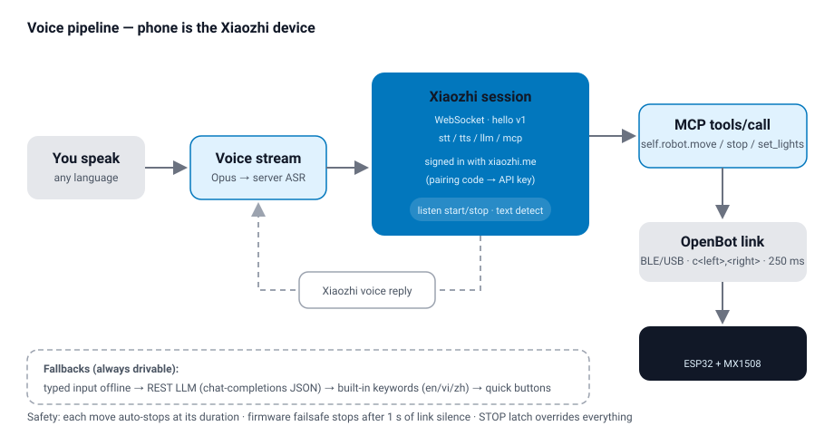

1. **You speak** — in English, Vietnamese or Chinese. The app streams your voice to Xiaozhi.
   *Example: "rẽ trái" (turn left).*
2. **Xiaozhi understands** — the server turns speech into text and decides what to do.
3. **Xiaozhi answers in two ways:**
   - it **talks back** in its own voice (the phone plays it), and
   - it **calls a robot tool** when the robot should act, e.g. `self.robot.move`
     with *direction = left*.
4. **The app drives the robot** over Bluetooth (BLE) or USB with the simple OpenBot message
   `c<left>,<right>` (each wheel −255…255). *Example: `c-150,150` = spin left.*
5. **The robot stops by itself** when the move's time is over.

Everything is also written in the on-screen chat, so you can see what was said and done.

> **What if there is no internet?** Typed commands and the quick buttons still work. A
> built-in keyword list (§8) understands simple words like "forward" or "dừng" without any
> server.
>
> *Source: `robot/android/.../robot/voice/` (`XiaozhiSession`, `VoiceInterpreter`,
> `VoiceCommand`), `robot/ios/OpenBot/OpenBot/Controllers/VoiceControl/`*

---

## 3. Wiring

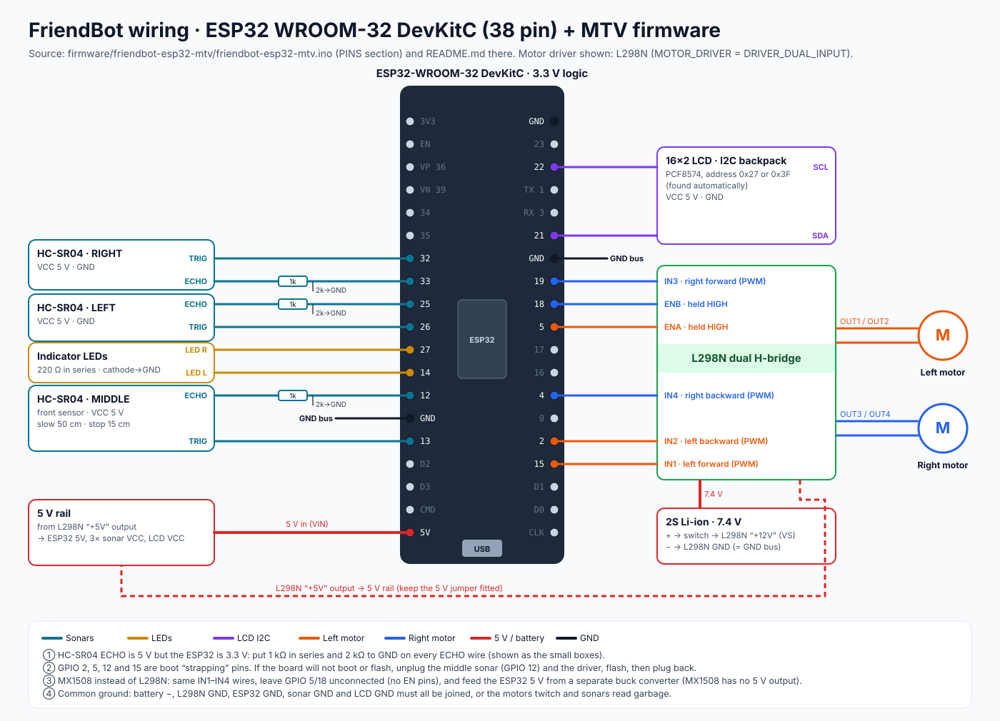

| Part | Signal | ESP32 GPIO |
|---|---|---|
| Right motor | IN1 forward (PWM) / IN2 backward (PWM) / EN | **19 / 4 / 18** |
| Left motor | IN1 forward (PWM) / IN2 backward (PWM) / EN | **15 / 2 / 5** |
| Sonar middle | TRIG / ECHO | **13 / 12** |
| Sonar left | TRIG / ECHO | **26 / 25** |
| Sonar right | TRIG / ECHO | **32 / 33** |
| LEDs | left / right | **14 / 27** |
| LCD (I2C, 0x27 or 0x3F) | SDA / SCL | **21 / 22** |

**Four rules that save hours:**

1. **One common ground.** Battery −, driver GND, ESP32 GND, sonar GND and LCD GND must all be
   joined. *Why? Without it, signals have no shared "zero", so motors twitch and sonars read
   nonsense.*
2. **Divide the sonar ECHO voltage.** HC-SR04 echo is 5 V, the ESP32 is 3.3 V. Put 1 kΩ in
   series and 2 kΩ to GND on every ECHO wire. *Why? 5 V slowly damages the ESP32 pin.*
3. **Never power motors from the ESP32.** Battery → driver `+12V`/`VCC`. *Why? Motors pull
   far more current than the board's 5 V pin can give.*
4. **Strapping pins (2, 5, 12, 15).** If the board will not boot or flash, unplug the middle
   sonar (GPIO 12) and the driver, flash, then plug back.

**Using an MX1508 instead of L298N?** Same IN1–IN4 wires, leave GPIO 5/18 unconnected (no EN
pins), and power the ESP32 from a separate 5 V buck converter.

*Source: `firmware/openbot-esp32-mtv/openbot-esp32-mtv.ino` (PINS section) and its README*

---

## 4. Flash the firmware

Use **`firmware/openbot-esp32-mtv/openbot-esp32-mtv.ino`**. It is a clean rewrite of the
OpenBot MTV sketch: real speed control in both directions, no `delay()` in the loop, sonar
safety, LED control and an LCD. (The older `firmware/openbot-esp32s3/` sketch is kept only
for reference.)

### Steps (Arduino IDE)

1. Install the **ESP32 board package** (Espressif, core 2.x or 3.x).
2. Board: **ESP32 Dev Module**.
3. Library Manager → install **LiquidCrystal I2C** (Frank de Brabander).
   NewPing is **not** needed.
4. Open `openbot-esp32-mtv.ino` → check the settings below → **Upload**.

Command-line alternative:

```bash
arduino-cli compile --fqbn esp32:esp32:esp32 firmware/openbot-esp32-mtv
arduino-cli upload  --fqbn esp32:esp32:esp32 --port /dev/tty.usbserial-0001 firmware/openbot-esp32-mtv
```

### Settings worth checking

| Setting | Default | What it means — example |
|---|---|---|
| `MOTOR_DRIVER` | `DRIVER_DUAL_INPUT` | L298N / MX1508. Use `DRIVER_PWM_DIR` for a Cytron-style PWM + DIR driver |
| `MOTOR_L_REVERSED` / `MOTOR_R_REVERSED` | `0` / `0` | Set to `1` if that wheel spins backwards on "forward" |
| `MOTOR_MIN_DUTY` | `60` | Smallest power that really turns the wheels. Wheels hum but don't move? Try `80` |
| `MOTOR_MAX_DUTY` | `255` | Full app speed maps to this. Robot too fast? Try `180` |
| `MOTOR_RAMP_STEP` | `20` | Soft start: max power increase per 10 ms |
| `FRONT_SLOW_CM` / `FRONT_STOP_CM` | `50` / `15` | Middle sonar: start slowing at 50 cm, stop forward at 15 cm |
| `SIDE_SLOW_CM` / `SIDE_STOP_CM` | `25` / `10` | Same for the left and right sonars |
| `ESCAPE_CM` / `ESCAPE_MAX_TRIES` | `5` / `2` | While driving, closer than 5 cm → backs off and turns to the open side, at most 2 times |
| `HAS_LCD` / `HAS_SONAR` / `HAS_INDICATORS` | `1` | Set to `0` for parts you did not fit |

### What the robot shows

- **Bluetooth name:** `OpenBot: MTV`
- **LCD:**
  ```
  L 200 R 200  BLE     <- motor outputs, link: BLE / USB / WAIT / LOST / STOP
  L 40 M120 Rmax       <- left / middle / right distance in cm (--- = sensor fault)
  ```

### Messages between phone and robot

| Direction | Message | Meaning — example |
|---|---|---|
| phone → robot | `c<left>,<right>` | Drive, −255…255 each. `c200,200` = forward |
| phone → robot | `h<ms>` | Heartbeat timeout. `h750` = stop if nothing for 750 ms |
| phone → robot | `f` | "What are you?" → robot replies with its features |
| phone → robot | `s<ms>` | Send sonar readings every *ms*. `s100` |
| phone → robot | `i<left>,<right>` | LEDs: 0 off, 1 on, 2 blink, 3 auto. `i2,0` = left signal |
| robot → phone | `s<cm>` | Free distance in front, e.g. `s42` |

*Source: `firmware/openbot-esp32-mtv/openbot-esp32-mtv.ino` (SETTINGS, `handle_message`)*

---

## 5. Install the app and connect

1. **Install FriendBot** on your phone — build it from `robot/android` (Android Studio) or
   `robot/ios` (Xcode).
2. **Turn on the robot.** The LCD shows `WAIT`.
3. In the app, open the **Bluetooth** screen and pick **`OpenBot: MTV`**
   (Android can also use a **USB cable**). The LCD changes to `BLE` or `USB`.
4. On the **Home** screen, open the **AI** section → **Voice Control**
   (the **Remote Mic** tile is right next to it).

> **Example:** Home → AI → Voice Control → the status line reads **"Connected (BLE)"**.
> You can talk to Xiaozhi before the robot is connected — it just won't move.

*Source: `robot/android/.../common/FeatureList.java` (AI category), iOS `Constants.swift`*

---

## 6. Pair with xiaozhi.me (first time only)

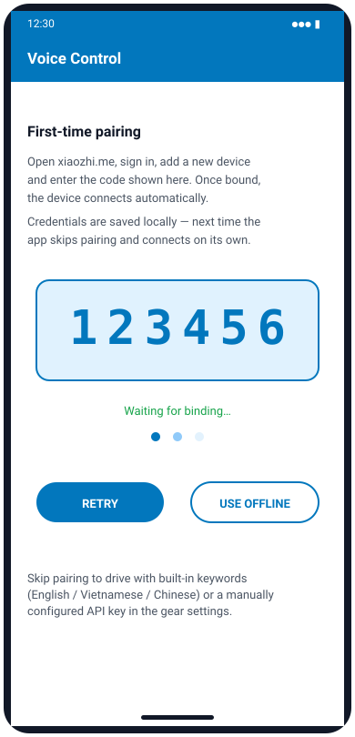

The first time you open Voice Control, the app registers itself as a Xiaozhi device:

1. The app shows a **verification code**.
2. On a computer or phone browser, go to **xiaozhi.me** → sign in → **Console → Agents** →
   **Add device** → type the code.
3. The app notices the binding and connects. You hear Xiaozhi's greeting.

The keys are **saved on the phone**, so next time it connects by itself.
**Use offline** skips pairing — you can still drive with buttons and simple keywords.

> **Why a code, not a password?** The code proves that *you* own this phone, without
> typing your xiaozhi.me password into the app. This is the same flow used by the
> [py-xiaozhi](https://github.com/huangjunsen0406/py-xiaozhi) and
> [whisplay-xiaozhi](https://github.com/PiSugar/whisplay-xiaozhi) clients.
>
> *Source: `XiaozhiActivator.java` (OTA endpoint `https://api.tenclass.net/xiaozhi/ota/`)*

---

## 7. Using the Voice Control screen

| Android | iOS |
|---|---|
| 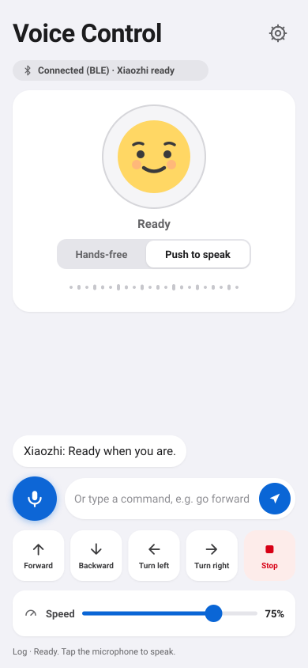 | 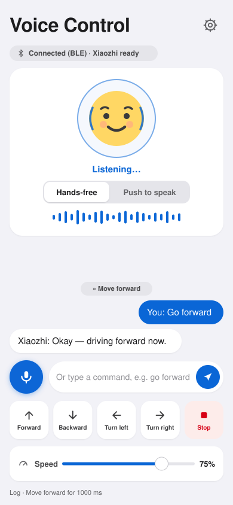 |

### Talking

- **Hands-free (default):** just talk. The face shows **Ready → Listening… → Thinking… →
  Speaking…**. The server notices when you finish a sentence.
- **Push to speak:** tap the mic, speak, tap again.
- **Interrupt:** tap the mic while Xiaozhi is speaking — it stops and listens again.
- **Type:** write a command and tap **Send**. *Example: `go forward slowly`.*

The chat shows **your words** on the right, **Xiaozhi's answers** on the left, and every robot
action as a chip, e.g. `» Move forward`.

### Quick buttons (no talking needed)

| Row | Buttons |
|---|---|
| 1 | **Forward · Backward · Left · Right · Stop** |
| 2 | **Lights** (toggle) · **Sonar** (shows *Distance: … cm*) · **Sing** · **Spin 360** |
| 3 | **Triangle · Circle · Left+Right · Turn 180** |

The **Speed** slider (25–100 %, default 75 %) scales every move.

### The camera — "what do you see?"

A small camera preview sits in the top-right corner. Ask *"What's in front of you?"* or
*"Có gì phía trước?"*: the phone takes a photo, Xiaozhi's vision service describes it, and the
answer is spoken. **Tap the preview** to take a photo yourself; the round button flips between
front and back camera.

### Several phones, one robot

- The phone connected to the robot **shares it over Wi-Fi** only while Voice Control is open,
  and shows a **4-digit PIN** (status: *"Connected (BLE) · Sharing over WiFi · PIN 4821"*).
- Another phone on the same Wi-Fi asks for that PIN once, then shows
  *"Controlling via <phone> (WiFi)"* and can drive too. *Why a PIN? Without it, anyone on a
  café or office Wi-Fi could drive your robot or talk into your Xiaozhi session.*
- **Tap the status line** to choose which robot to control.
- **Stop from any phone stops the robot for everyone.**

### Remote Mic

Open **Remote Mic** on a second phone to use it as a wireless microphone for the phone that
holds the robot. It needs no Xiaozhi pairing, only the host's PIN; replies still play on the
host phone.

> **Example:** the host phone sits on the robot; you walk around with your own phone in
> Remote Mic and say *"turn around"*.
>
> *Source: `VoiceControlFragment.java`, `RemoteMicFragment.java`, `voice/relay/`,
> `PhotoExplainer.java`*

---

## 8. Voice commands

Say them, type them, or use them offline. With Xiaozhi online, natural sentences work too —
*"drive backwards slowly for three seconds"*, *"quay phải rồi hát"*.

| English | Tiếng Việt | 中文 | What happens |
|---|---|---|---|
| forward, go, straight | tiến, đi | 前进, 向前, 走 | Drive forward |
| back, reverse | lùi, lùi lại | 后退, 向后 | Drive backward |
| left, turn left | trái, rẽ trái | 左, 左转 | Spin left |
| right, turn right | phải, rẽ phải | 右, 右转 | Spin right |
| **stop**, halt | **dừng**, dừng lại | **停**, 停止 | Stop now (always wins) |
| faster / slower | nhanh / chậm | 快 / 慢 | Speed ±15 % |
| lights on / off | bật đèn / tắt đèn | 开灯 / 关灯 | Both LEDs on / off |
| signal left / right | xi nhan trái / phải | 左 / 右转向灯 | That LED blinks |
| hazard | đèn hazard | 危险灯 | Both LEDs blink |
| signals off | tắt xi nhan | 关转向灯 | Signals off |
| distance, how far | khoảng cách | 距离 | Reads the sonar: *Distance: 42 cm* |
| sing | hát | 唱歌 | Sings and spins around |
| triangle / circle | tam giác / vòng tròn | 三角形 / 圆形 | Drives that shape |
| spin, 360 | xoay, một vòng | 旋转 | Spins 360° in place |
| turn around | quay đầu | 掉头 | Turns 180° |
| left and right | trái phải | 左右 | Wiggles left–right |
| go forward 5 seconds | tiến 5 giây | 走5秒 | Moves for that time (max 15 s) |

**Two matching rules:** "stop" beats every other word (*"dừng lại"* never drives), and
"left and right" is checked before plain "left".

### Robot tools Xiaozhi can call (MCP)

| Tool | Parameters | Does |
|---|---|---|
| `self.robot.move` | direction, speed, duration_ms (≤ 15000) | Drive |
| `self.robot.stop` | — | Stop |
| `self.robot.led` | state: on / off | Lights |
| `self.robot.indicator` | state: left / right / both / off | Turn signals |
| `self.robot.sonar` | — | Read distance |
| `self.robot.trick` | name: sing / triangle / circle / spin / turn_around / wiggle | Tricks |
| `self.camera.take_photo` | question | Look and describe |

*Source: `VoiceInterpreter.java`, `VoiceCommand.java`, `XiaozhiSession.java`*

---

## 9. Configuring Xiaozhi

Tap the **gear** on the Voice Control screen.

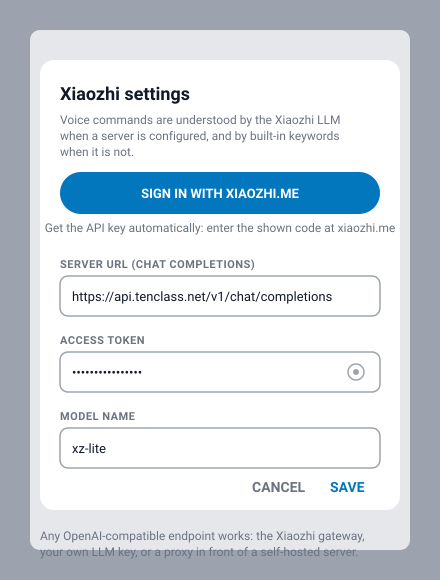

- **Sign in with xiaozhi.me** — re-runs the pairing of §6 and fills in the key for you.
- **Manual setup** (for typed commands when the live session is offline):

| Field | Default | Note |
|---|---|---|
| Server URL | `https://api.tenclass.net/v1/chat/completions` | Any OpenAI-compatible endpoint works (OpenAI, DeepSeek, your own server) |
| Access token | filled by sign-in | Leave empty to use keywords only |
| Model name | `xz-lite` | e.g. `qwen`, `deepseek` — whatever your server offers |
| Voice language | phone language | Affects typed / offline replies; spoken replies follow Xiaozhi |

The app asks the model for one JSON answer, for example:

```json
{"action": "forward", "speed": 0.6, "duration_ms": 3000, "say": "Going forward for 3 seconds!"}
```

`"action": "none"` means just chatting — no movement.

*Source: `XiaozhiClient.java`, `VoiceControlFragment.java` (settings dialog)*

---

## 10. AI and camera features

Besides voice, FriendBot can drive itself with the phone's camera. Open them from **Home**:

| Where on Home | Feature | In one line |
|---|---|---|
| **AI** | [Autopilot](#101-autopilot) | A neural network looks at the road and steers |
| **AI** | [Object Tracking](#102-object-tracking-follow-me) | Finds a person, dog, ball… and drives to it |
| **Vision Modes** | [Follow a Coloured Object](#103-follow-a-coloured-object) | Tap a colour, the robot follows it |
| **Vision Modes** | [Follow a Face](#104-follow-a-face) | Keeps your face in view |
| **Vision Modes** | [Follow a Black Line](#105-follow-a-black-line) | Drives along a tape circuit on the floor |
| **Vision Modes** | [Object Avoidance](#106-object-avoidance) | Drives on and turns away from an obstacle |
| **Vision Modes** | [Target Tracking](#107-target-tracking) | Draw a box round anything, the robot follows it |

**Rules for all of them**
- **Mount the phone upright** on the robot, back camera facing forward (down at the floor for Black Line).
- Press **Auto** (or **Auto Mode**) to start, turn it off to stop. Leaving the page also stops the robot.
- **»** sets the speed: Slow / Normal / Fast = 128 / 192 / 255 of 255.
- **The firmware still protects the robot**: its sonars slow it from 50 cm and stop it at 15 cm, and the red **STOP** overrides everything. *Why this matters:* a camera or a neural network can be wrong; the sonar stop doesn't depend on them.
- Vision Modes have a **How to use** button that opens step-by-step instructions.

> The AI features come from [OpenBot](https://www.openbot.org). The Vision Modes are based on
> [Kirstin813/L4-Individual-Project](https://github.com/Kirstin813/L4-Individual-Project) and
> [longpth/Android-Object-Tracking-OpenCV](https://github.com/longpth/Android-Object-Tracking-OpenCV).
>
> *Source:* Android `robot/android/app/src/main/java/org/openbot/app/robot/` (`autopilot/`,
> `objectNav/`, `tracking/MultiBoxTracker.java`, `vision/`), iOS
> `robot/ios/OpenBot/OpenBot/Controllers/` (`Autopilot/`, `ObjectTracking/`, `Vision/`).

### 10.1 Autopilot

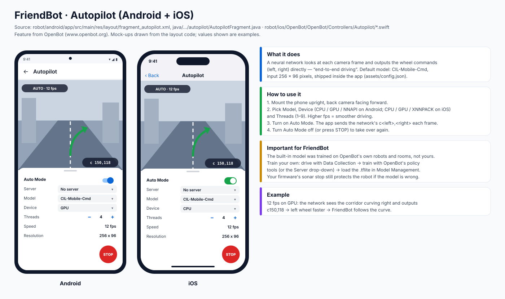

**What it does.** A neural network looks at every camera frame and outputs the wheel commands
directly (*end-to-end driving*). The built-in model is **CIL-Mobile-Cmd** (256 × 96 input).

**How to use it**
1. Choose the **Model**, the **Device** (CPU / GPU / NNAPI on Android, CPU / GPU / XNNPACK on
   iOS) and the **Threads**. The **Speed** line shows frames per second — more fps, smoother driving.
2. Turn on **Auto Mode**. Each frame the app sends the network's `c<left>,<right>` to the robot.
3. Turn Auto Mode off, or press **STOP**, to take over.

> **Example:** at 12 fps on the GPU the network sees the corridor bend right and outputs
> `c150,118` — the left wheel turns faster, so FriendBot follows the bend.

**Important:** the built-in model was trained on OpenBot's robots and rooms, not on your house.
It drives, but not well. For good results, record your own driving with **Data Collection**,
train with OpenBot's `policy` tools, and add the `.tflite` file in **Model Management**.
*Why:* the network only knows places that look like its training pictures.

### 10.2 Object Tracking ("follow me")

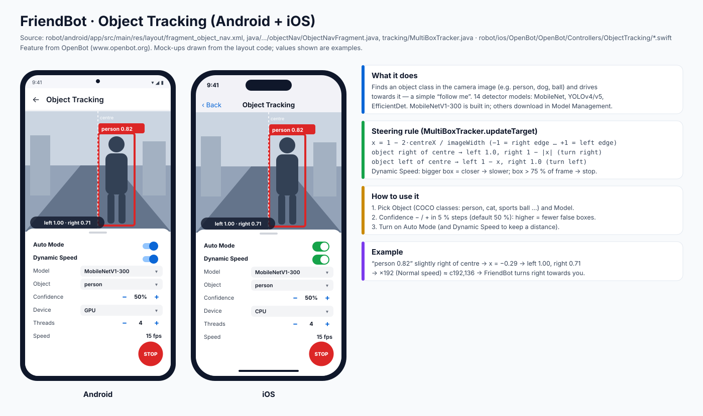

**What it does.** Finds one kind of object — a person, a dog, a sports ball (80 COCO classes) —
and drives towards it. **MobileNetV1-300** is built in; YOLO and EfficientDet models download in
Model Management.

**How to use it**
1. Pick the **Object** (e.g. `person`) and the **Model**.
2. Set **Confidence** (default 50 %). Higher = fewer false boxes, but the robot loses you more often.
3. Turn on **Auto Mode**, and **Dynamic Speed** so it slows down and stops before it reaches you.

**How it steers** (`MultiBoxTracker.updateTarget`): the further the object is from the centre,
the more the robot turns towards it. With Dynamic Speed, the bigger the box, the slower it goes:
under 25 % of the picture = full speed, over 75 % = stop.

> **Example:** "person 0.82" a little right of centre → about `c192,136` at Normal speed →
> FriendBot curves right towards you, and stops when you fill most of the picture.

*Tip:* it follows the most confident detection. If two people are in view, ask one to step aside.

### 10.3 Follow a Coloured Object

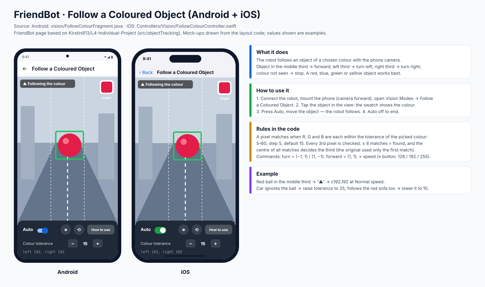

**What it does.** The robot follows an object of a colour you pick.

**How to use it**
1. **Tap the object** in the camera view to sample its colour (the swatch shows it).
2. Press **Auto**. Object in the middle third → drive forward; left / right third → turn that way.
3. Colour lost → the robot stops.

**Setting:** **Colour tolerance** 5–60 (default 15) — how close a pixel must be to the picked colour.

> **Example:** red ball in the middle → `c192,192`. The robot ignores the ball → raise the
> tolerance to 25. It follows the red sofa too → lower it to 10.

*Tip:* use a bright, solid colour (red, blue, green, yellow) that stands out from the room, in even light.

### 10.4 Follow a Face

**What it does.** The camera finds your face (Google ML Kit on Android, Apple Vision on iOS) and
the robot keeps you in view.

| | Android | iOS |
|---|---|---|
| How it moves | **Drives towards you**, steering like Object Tracking; slows as your face gets bigger and **stops when it fills most of the view** | **Turns on the spot** to face you; centre third = stop, it **never drives at you** |

**How to use it:** Follow a Face → **Auto** → a box appears round your face → move left or right
and the robot follows.

> **Example (iOS):** you step to the robot's left → `c-192,192` → it spins left until your face is
> centred, then stops.

*Tips:* works up to about 2 m; keep your face well lit (no window behind you); one face at a time.

### 10.5 Follow a Black Line

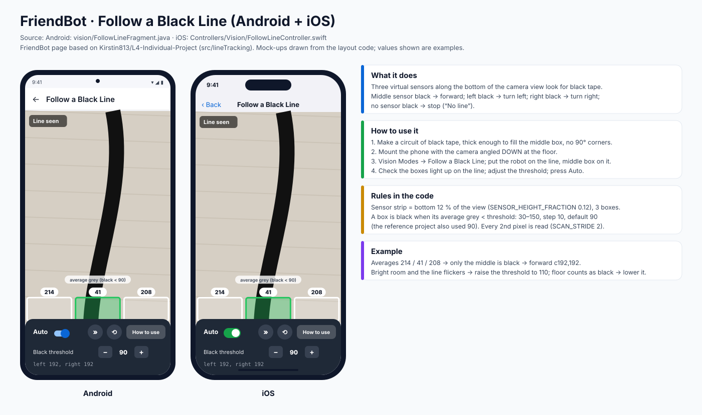

**What it does.** The camera looks down at the floor. **Three virtual sensors** along the bottom
of the picture look for the line: middle → forward, left → turn left, right → turn right, none →
stop ("No line").

**How to use it**
1. Make a circuit from **black tape** — thick lines, no sharp 90° corners.
2. Point the camera **down** at the floor and put the robot on the line.
3. Check that the sensor boxes light up on the line, then press **Auto**.

**Settings:** **Black threshold** 30–150 (default 90): lower it in bright light. On Android you can
also pick the **line colour** (black, red, green, blue, yellow) and the robot curves smoothly like
Object Tracking; on iOS it turns on the spot.

> **Example:** sensor brightness left 214 / middle 41 / right 208 → only the middle is under 90 →
> forward.

*Why 90:* it is the "black" value of the original project on a 0–255 grey scale.

### 10.6 Object Avoidance

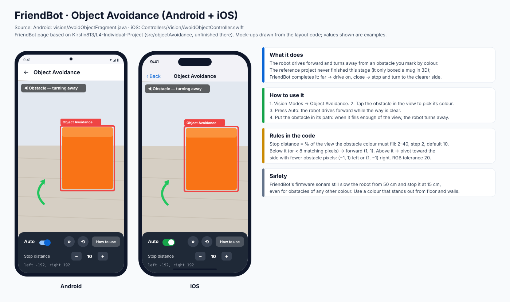

**What it does.** The robot drives forward and turns away from an obstacle you mark by colour.

**How to use it:** **tap the obstacle** to pick its colour → **Auto** → while it is small in the
picture (far away) the robot drives on; when it gets big (close) the robot turns to the side with
more free space.

**Setting:** **Stop distance** 2–40 % (default 10 %) — how much of the picture the obstacle must
fill before the robot turns.

> **Example:** an orange box fills the right part of the view → "◀ Obstacle — turning away" →
> `c-192,192`.

*Safety:* the sonars still stop the robot at 15 cm, even for an obstacle of **another colour**.

### 10.7 Target Tracking

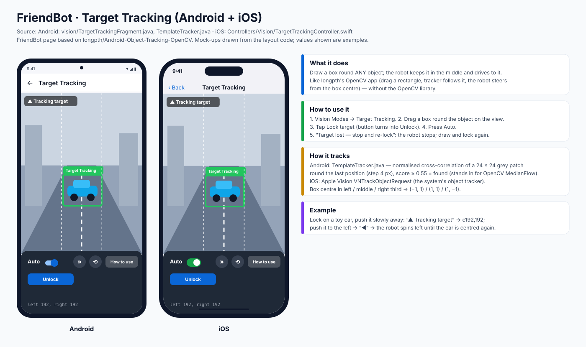

**What it does.** You draw a box round **any** object and the robot keeps it in the middle and
drives to it — without a big library like OpenCV (Android: a small template tracker; iOS: Apple
Vision's object tracker).

**How to use it**
1. **Drag a box** round the object, then tap **Lock target**.
2. Press **Auto**: box in left / middle / right third → spin left / forward / spin right.
3. **"Target lost — stop and re-lock"**: the robot stops; draw a new box and lock again.
   *Why stop?* The original app kept driving after it lost the target — not safe.

> **Example:** lock on a toy car and push it slowly away → "▲ Tracking target" → `c192,192`.

*Tip:* pick an object with texture and contrast; plain white walls are hard to track.

---

## 11. Safety

The robot has **several independent layers**, so one failure does not cause a crash:

| Layer | What it does |
|---|---|
| App — move timer | Every move stops after its time (default 1.2 s, max 15 s) |
| App — red STOP | The dashboard STOP latch blocks all commands until you release it |
| App — leave screen | Leaving Voice Control stops the motors |
| App — unknown words | If the command is not understood, the robot stops |
| App — bad tool calls | Unknown or broken MCP calls are rejected |
| Firmware — sonar | Slows forward at 50 cm, stops at 15 cm; reversing and turning still work |
| Firmware — escape | While driving and under 5 cm: backs away and turns to the open side (max 2 tries; STOP cancels it; never moves a parked robot) |
| Firmware — link loss | Bluetooth disconnect → stop. USB heartbeat missing 750 ms → stop |

> **Why both app and firmware?** If the phone freezes or the Bluetooth drops, the app cannot
> help any more — the firmware still can.
>
> **Test tip:** do your first runs with the **wheels off the ground**.

---

## 12. Troubleshooting

| Problem | Likely cause → fix |
|---|---|
| Wheels hum but don't turn | Not enough power → raise `MOTOR_MIN_DUTY` (60 → 80), check the battery |
| One wheel turns backwards | Set `MOTOR_L_REVERSED` or `MOTOR_R_REVERSED` to `1` |
| Robot won't go forward, but reverses fine | Something is close to a sonar → check the LCD distances |
| LCD left/right distances swapped | Swap the two sonar pin lines in the firmware |
| LCD blank | Turn the blue contrast screw on the back of the LCD |
| Board won't boot or flash | Unplug the sonar on GPIO 12 and the driver while flashing |
| "Robot not connected" | Connect `OpenBot: MTV` on the Bluetooth screen first |
| No answer to voice | Allow microphone; the phone needs Wi-Fi or data |
| Code not accepted at xiaozhi.me | It expired → tap **Retry** and enter the new code |
| "Xiaozhi ready" never shows | Saved keys are stale → gear → **Sign in with xiaozhi.me** |
| Xiaozhi chats but robot doesn't move | Say a clear command ("go forward") or use the buttons |
| Photo / vision fails | Allow camera; reconnect so the server sends the vision URL and token |
| Move stops early | STOP latch is on, or the link dropped |
| Second phone keeps asking for a PIN | Type the PIN shown on the robot phone's Voice Control status line |

---

## 13. Questions to go deeper

Ask yourself **"why?"** for each — it makes the design clear.

1. *Why does the phone, not the ESP32, run the voice assistant?*
   (Hint: microphone, speaker, internet and CPU power are already in the phone.)
2. *Why does each move have a time limit instead of "go forward until I say stop"?*
   (Hint: what happens if the internet drops in the middle of a move?)
3. *Why does the sonar safety block forward but still allow reverse and turning?*
4. *Why does "stop" win over every other word in the same sentence?*
5. *What would change if you used an MX1508 instead of an L298N — and why does the ESP32 then
   need its own 5 V supply?*
6. *How could you add a new trick (for example "dance") — which file holds the keywords, and
   which holds the MCP tool list?*
7. *Why does Autopilot drive well in OpenBot's test rooms but poorly in your house — and what
   data would you collect to fix it?*
8. *Follow a Face on iOS stops when your face is centred, but Object Tracking drives towards you.
   Which is safer for a robot near people, and why?*

---

*FriendBot is based on [OpenBot](https://www.openbot.org/) (MIT License). Voice by
[Xiaozhi](https://xiaozhi.me).*
