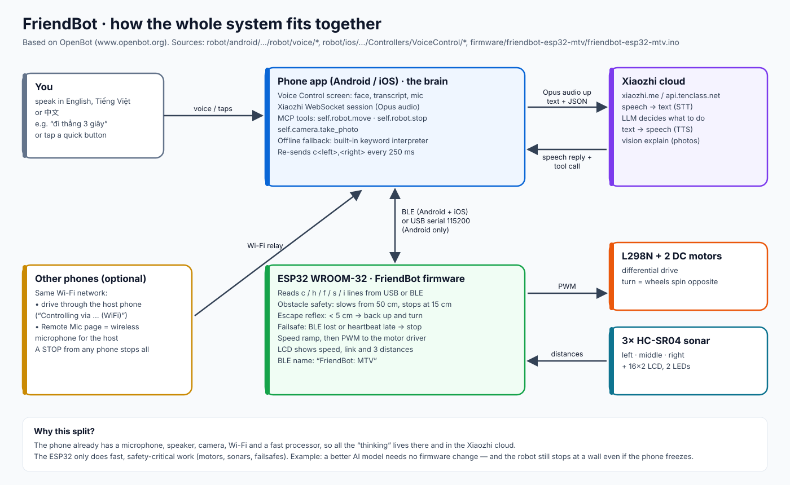

# FriendBot

**A phone-brained robot car you drive by talking to it.**
You speak in English, Tiếng Việt or 中文 → the phone sends your voice to the **Xiaozhi** AI → the AI answers out loud and sends a move command → the phone tells the **ESP32** to turn the wheels.

> FriendBot is based on **[OpenBot](https://www.openbot.org)** — the open-source "smartphone as robot brain" project by Intel Labs ([github.com/isl-org/OpenBot](https://github.com/isl-org/OpenBot), MIT licence). FriendBot keeps OpenBot's app framework, Bluetooth/USB protocol and body designs, and adds a Xiaozhi voice assistant, a camera "eye", multi-phone control and a new 3-sonar firmware. Some code names (for example the Android package `org.openbot.app.robot` and the iOS project folder `robot/ios/OpenBot`) still say "OpenBot" on purpose: renaming them would break the builds and links to the original project.



## Download

| What | Where |
|---|---|
| **Android app (APK)** | [`apk/FriendBot-android-debug.apk`](apk/FriendBot-android-debug.apk) → on GitHub tap **Download raw file** |
| iOS app | build it with Xcode (Apple does not allow installing iPhone apps from GitHub), see [iOS guide](docs/IOS_APP.md) |
| Firmware | [`firmware/friendbot-esp32-mtv/`](firmware/friendbot-esp32-mtv/) (Arduino sketch) |

## The guides

| Guide | What you learn | Diagram |
|---|---|---|
| [1. Wiring](docs/WIRING.md) | Which wire goes to which ESP32 pin, power, safety resistors | [wiring.svg](docs/images/wiring.svg) |
| [2. Firmware](docs/FIRMWARE.md) | How to flash, what each setting does, how the robot keeps itself safe | [firmware-flow.svg](docs/images/firmware-flow.svg) |
| [3. Android app](docs/ANDROID_APP.md) | Install the APK, connect by USB or Bluetooth, pair Xiaozhi, talk | [android-app.svg](docs/images/android-app.svg) |
| [4. iOS app](docs/IOS_APP.md) | Build in Xcode, connect by Bluetooth, pair Xiaozhi, talk | [ios-app.svg](docs/images/ios-app.svg) |
| [5. Connect to xiaozhi.me](docs/XIAOZHI_PAIRING.md) | Create the account and agent, get the 6-digit code, bind the phone | [xiaozhi-connect.svg](docs/images/xiaozhi-connect.svg) |
| [6. Other app screens](docs/APP_SCREENS.md) | Home dashboard, Bluetooth, Car setup, Drive, GPS Mission, Remote Mic, Settings | [android-screens.svg](docs/images/android-screens.svg) · [ios-screens.svg](docs/images/ios-screens.svg) |

## Quick start (about 1 hour)

1. **Wire it** — ESP32 WROOM-32 DevKitC + L298N + 2 motors + 3 HC-SR04 sonars + 16×2 I2C LCD. → [Wiring](docs/WIRING.md)
2. **Flash it** — Arduino IDE, board *ESP32 Dev Module*, library *LiquidCrystal I2C*, open `friendbot-esp32-mtv.ino`, Upload. The LCD shows `FriendBot MTV`. → [Firmware](docs/FIRMWARE.md)
3. **Install the app** — Android: APK from the `apk/` folder. iPhone: Xcode build. → [Android](docs/ANDROID_APP.md) · [iOS](docs/IOS_APP.md)
4. **Connect** — Bluetooth device **`FriendBot: MTV`** (or USB cable on Android).
5. **Open Voice Control → pair once at xiaozhi.me** ([step-by-step](docs/XIAOZHI_PAIRING.md)) **→ say "go forward".**

*Example:* say **"đi thẳng 3 giây"** (go straight 3 seconds). Xiaozhi replies "Được, đang đi thẳng!", calls `self.robot.move(forward, 3000 ms)`, the app sends `c144,144` every 250 ms, and after 3 s sends `c0,0`. If a wall appears at 30 cm, the firmware slows the car on its own; at 15 cm it stops.

## Repository layout

```
FriendBot/
├── README.md                    ← you are here
├── docs/                        ← guides + SVG diagrams
│   └── images/                  ← system, wiring, firmware, Android, iOS, Xiaozhi screens
├── firmware/friendbot-esp32-mtv/← ESP32 Arduino sketch (3 sonars, LCD, BLE + USB)
└── robot/
    ├── android/                 ← Android app (Android Studio project)
    └── ios/                     ← iOS app (Xcode + CocoaPods project)
```

## Why is it built this way?

- **Why put the AI on the phone and in the cloud, not on the ESP32?** The phone already has a microphone, speaker, camera and internet. The ESP32 stays cheap and simple. *Example:* switching Xiaozhi to a better model needs no firmware change.
- **Why keep safety in the firmware, not only in the app?** The firmware reacts in about 1 ms and does not depend on Wi-Fi or the phone. *Example:* if the phone freezes while driving, the heartbeat stops and the robot stops; if a wall appears, the sonars stop the robot even if the app still says "forward".
- **Why keep OpenBot's message format?** So the stock OpenBot features (joystick, autopilot, object tracking) keep working with the same robot.

## Questions to go deeper

1. Why does FriendBot scale only the *forward* part of a command near a wall, and never the *turn* part? (Hint: [Firmware → apply_safety](docs/FIRMWARE.md#4-the-safety-layers).)
2. What should the robot do if the internet drops in the middle of a 3-second move — and which layer handles it?
3. Why can the iPhone app only use Bluetooth, while Android can also use a USB cable?
4. If you add wheel encoders later, which firmware step would use them, and what would improve?
5. How would you make "follow me" work with the phone camera and the existing `self.robot.move` tool?

## Credits and licence

- Based on **OpenBot** — [www.openbot.org](https://www.openbot.org) · [github.com/isl-org/OpenBot](https://github.com/isl-org/OpenBot) · paper: *OpenBot: Turning Smartphones into Robots*, M. Müller and V. Koltun, ICRA 2021.
- Voice assistant: **Xiaozhi** ([xiaozhi.me](https://xiaozhi.me)), protocol as used by [xiaozhi-esp32](https://github.com/78/xiaozhi-esp32).
- FriendBot changes © 2026 Vu Nguyen. Released under the MIT licence; see [LICENSE](LICENSE) (the original OpenBot copyright notice is kept as the licence requires).
