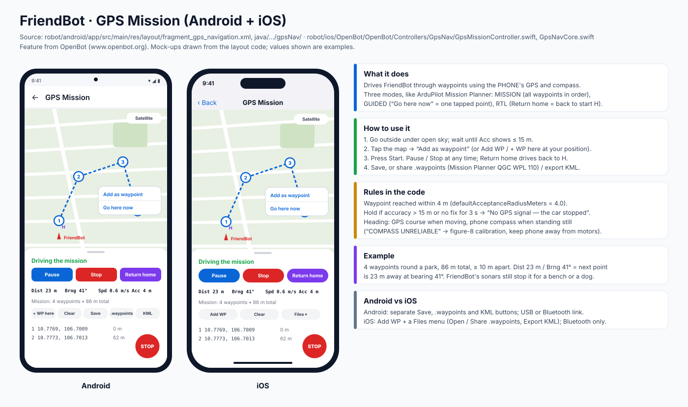
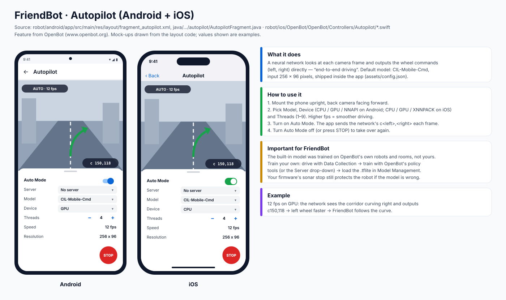
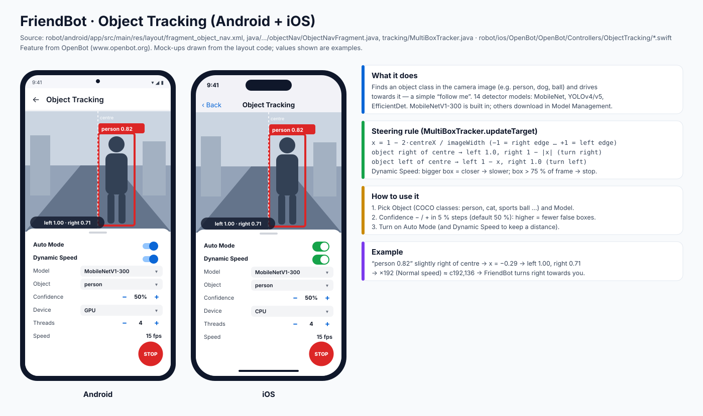
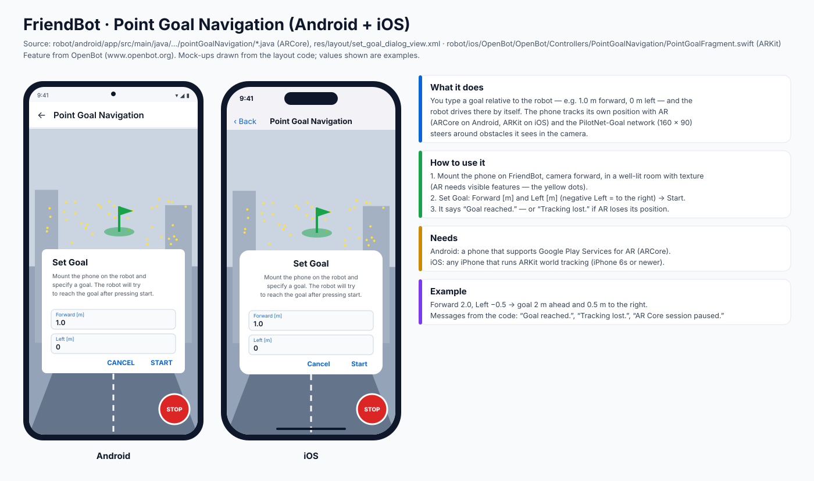
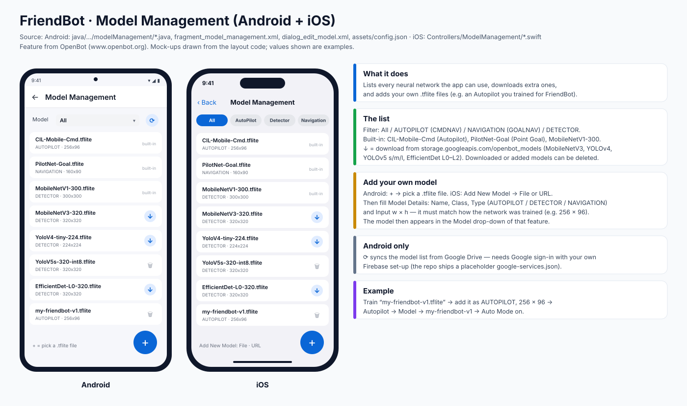

# 7 · GPS Mission and the AI screens (Android and iOS)

This guide covers the five "smart" screens: **GPS Mission**, **Autopilot**, **Object Tracking**, **Point Goal Navigation** and **Model Management**. Each section has a diagram with the Android and iOS screens side by side, then what the screen does, how to use it, a worked example, and why it works that way.

*Sources:* the Android code in `robot/android/app/src/main/` (`gpsNav/`, `autopilot/`, `objectNav/`, `tracking/MultiBoxTracker.java`, `pointGoalNavigation/`, `modelManagement/`, `assets/config.json`) and the iOS code in `robot/ios/OpenBot/OpenBot/Controllers/` (`GpsNav/`, `Autopilot/`, `ObjectTracking/`, `PointGoalNavigation/`, `ModelManagement/`). The four AI features come from **[OpenBot](https://www.openbot.org)**. GPS Mission was added for FriendBot.

**One rule for all five screens:** the robot's own firmware keeps protecting it. Its sonars slow it from 50 cm and stop it at 15 cm, and the big red **STOP** button overrides any AI. *Why this matters:* a neural network can be wrong, and the sonar stop does not depend on it. See [Firmware → safety layers](FIRMWARE.md#4-the-safety-layers).

Open them from **Home → More features** (GPS Mission is also a Home tile).

---

## 1 · GPS Mission



**What it does.** Drives FriendBot through waypoints using the **phone's own GPS and compass**. There are three modes, as in ArduPilot Mission Planner:

| Mode | How you start it | What the robot does |
|---|---|---|
| **MISSION** | add waypoints → **Start** | visits waypoints 1, 2, 3… in order |
| **GUIDED** | tap the map → **Go here now** | drives to that one point |
| **RTL** | **Return home** | drives back to the start point **H** |

**How to use it**
1. Go outside under open sky and wait until **Acc** shows 15 m or better.
2. Tap the map → **Add as waypoint**, or use **+ WP here** (Android) / **Add WP** (iOS) to add your current position.
3. Press **Start**. You can **Pause** or **Stop** at any time. **Return home** drives back to H.
4. Save the mission, share it as a `.waypoints` file (Mission Planner format QGC WPL 110), or export it as **KML** for Google Earth.

**Rules in the code**
* A waypoint counts as reached within **4 m** (`Waypoint.DEFAULT_ACCEPTANCE_RADIUS_M = 4.0` on Android, `defaultAcceptanceRadiusMeters = 4.0` on iOS).
* The robot **holds** if GPS accuracy is worse than **15 m** or there has been no fix for **3 s**: *"No GPS signal — the car stopped and waits. Move to open sky."*
* Heading comes from the GPS course while moving, and from the phone compass when standing still. *"COMPASS UNRELIABLE"* means: calibrate with a figure 8, or move the phone away from the motors.

**Example.** 4 waypoints around a park, 86 m in total, each at least 10 m apart. The HUD shows `Dist 23 m · Brng 41°`, which means the next point is 23 m away at compass bearing 41°.

**Android vs iOS.** Android has separate **Save / .waypoints / KML** buttons and can use USB or Bluetooth. iOS has **Add WP** plus a **Files** menu, and uses Bluetooth only.

*Why 4 m and not 1 m:* phone GPS is only accurate to about 3–5 m. With a 1 m radius the robot would circle forever around a point it can never be sure it reached.

---

## 2 · Autopilot



**What it does.** A neural network looks at every camera frame and outputs the wheel commands directly. This is called *end-to-end driving*. The default model is **CIL-Mobile-Cmd**, with a 256 × 96 pixel input, and it ships inside the app.

**How to use it**
1. Mount the phone upright with the back camera facing forward.
2. Choose the **Model**, the **Device** and the **Threads** (1–9). Device options: CPU / GPU / NNAPI on Android, CPU / GPU / XNNPACK on iOS. The **Speed** line shows frames per second. More fps means smoother driving.
3. Turn on **Auto Mode**. Each frame, the app sends the network's `c<left>,<right>` to the robot.
4. To take over, turn Auto Mode off or press **STOP**.

**Important for FriendBot.** The built-in model was trained on OpenBot's own robots and rooms, not on your robot or your house. It will drive, but not well. For good results, train your own model:
1. Collect data: **Data Collection** while you drive by hand.
2. Train it with OpenBot's `policy` tools (see openbot.org), or use a training server through the **Server** drop-down.
3. Add the `.tflite` file in **Model Management** (section 5).

**Example.** At 12 fps on the GPU, the network sees the corridor bending right and outputs `c150,118`. The left wheel turns faster, so FriendBot follows the bend.

*Why the camera is enough:* the network learned from many examples which picture goes with which steering. That is also why it only works well in places that look like its training data.

---

## 3 · Object Tracking ("follow me")



**What it does.** Finds one type of object in the camera image, such as a person, a dog or a sports ball, and drives towards it. There are 14 detector models: MobileNet, YOLOv4/v5 and EfficientDet. **MobileNetV1-300** is built in. The others download in Model Management.

**Steering rule** (`MultiBoxTracker.updateTarget`):

```
x = 1 − 2 · centreX / imageWidth          (−1 = right edge … +1 = left edge)
object right of centre → left = 1.0,     right = 1 − |x|     (turns right)
object left of centre  → left = 1 − x,   right = 1.0         (turns left)
Dynamic Speed: speed × (1 − box area / frame area)
               box < 25 % of frame → full speed · box > 75 % → stop
```

**How to use it**
1. Pick the **Object** (a COCO class, e.g. `person`) and the **Model**.
2. Set **Confidence** with − / + in 5 % steps. The default is 50 %. Higher means fewer false boxes, but the robot may lose you more often.
3. Turn on **Auto Mode**. Turn on **Dynamic Speed** too, so the robot slows down and stops before it reaches you.

**Example.** The camera finds "person 0.82" a little right of centre, so x = −0.29 → left 1.00, right 0.71. At Normal speed (×192) the app sends about `c192,136`, and FriendBot turns right towards you. When you are close enough to fill most of the image, Dynamic Speed stops it.

*Why only the biggest/most confident box:* the tracker picks the top detection. If two people are in view, the robot follows whoever the model is most sure about. Ask everyone else to step out of view when you test.

---

## 4 · Point Goal Navigation



**What it does.** You give a goal relative to the robot, for example *1.0 m forward, 0 m left*, and FriendBot drives there by itself. The phone tracks its own position with augmented reality: **ARCore** on Android, **ARKit** on iOS. The **PilotNet-Goal** network (160 × 90 input) steers around obstacles it sees in the camera.

**How to use it**
1. Mount the phone on FriendBot with the camera facing forward. Use a well-lit room with some texture on the floor and walls. AR needs visible features, shown as the yellow dots in the diagram.
2. In the **Set Goal** dialog, enter **Forward [m]** and **Left [m]**, then press **Start**. Use a negative Left value to go right.
3. The app says *"Goal reached."*, or *"Tracking lost."* if AR loses its position.

**Needs.** Android: a phone that supports *Google Play Services for AR*. iOS: an iPhone with ARKit world tracking (iPhone 6s or newer).

**Example.** Forward `2.0`, Left `-0.5` puts the goal 2 m ahead and 0.5 m to the right.

*Why AR is needed:* FriendBot has no wheel encoders, so it cannot measure how far it has driven. The phone's AR measures that from the camera and motion sensors instead.

---

## 5 · Model Management



**What it does.** Lists every neural network the app can use, downloads extra ones, and adds your own `.tflite` files.

| Model | Type | Input | Where |
|---|---|---|---|
| CIL-Mobile-Cmd | AUTOPILOT | 256×96 | built in |
| PilotNet-Goal | NAVIGATION | 160×90 | built in |
| MobileNetV1-300 | DETECTOR | 300×300 | built in |
| MobileNetV3-320, YoloV4-tiny-224/416, YoloV4-224, YoloV5s-320/640, YoloV5m-320, YoloV5l-320, EfficientDet-L0/L1/L2 | DETECTOR | 224–640 | ↓ download |

*Source:* `robot/android/app/src/main/assets/config.json`. Downloads come from `storage.googleapis.com/openbot_models`.

**Add your own model**
1. Android: tap **+** and pick a `.tflite` file. iOS: **Add New Model → File** or **URL**.
2. Fill in **Model Details** (diagram: `screens/*/15-model-details-dialog.svg`): **Name**, **Class**, **Type** (AUTOPILOT / DETECTOR / NAVIGATION) and **Input w × h**.
3. The model now appears in the **Model** drop-down of the matching screen.

**Filter** the list by All / AUTOPILOT / NAVIGATION / DETECTOR. Android only: **⟳** syncs the list from Google Drive. This needs Google sign-in with your own Firebase project, because the repo ships a placeholder `google-services.json`.

**Example.** You train `my-friendbot-v1.tflite` and add it as AUTOPILOT, 256 × 96. Then open Autopilot → Model → `my-friendbot-v1` → Auto Mode on.

*Why the input size must match:* the network expects exactly the image size it was trained on. A wrong size gives garbage steering, or the model fails to load.

*Which detector to choose:* small and fast models (MobileNet, YOLOv4-tiny-224) keep the fps high on older phones, so following is smoother. Big models (YOLOv5l, EfficientDet-L2) see small or far objects better but may run at only 2–5 fps.

---

## Single-screen SVGs

Each screen also exists as its own file in `docs/images/screens/android/` and `docs/images/screens/ios/`:
`10-gps-mission-detail`, `11-autopilot`, `12-object-tracking`, `13-point-goal-navigation`, `14-model-management`, `15-model-details-dialog`.

## Questions to go deeper

1. Autopilot and Object Tracking both output `c<left>,<right>`. Which one would you trust more in a new room, and why?
2. If FriendBot follows the wrong person, which two settings would you change first, and what does each one cost you?
3. Point Goal Navigation needs AR because FriendBot has no wheel encoders. What would wheel encoders add, and what problems would they still have?
4. GPS Mission holds when accuracy is worse than 15 m. What could happen if the hold limit were 50 m?
5. How much data would you need to collect to train an Autopilot for your living room, and how would you test it safely (hint: wheels off the ground, then STOP within reach)?
