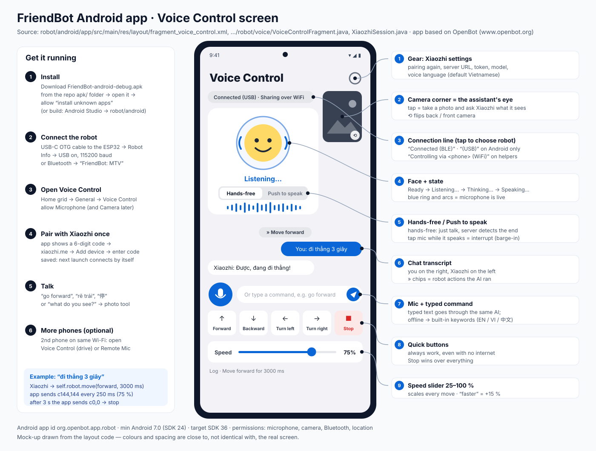
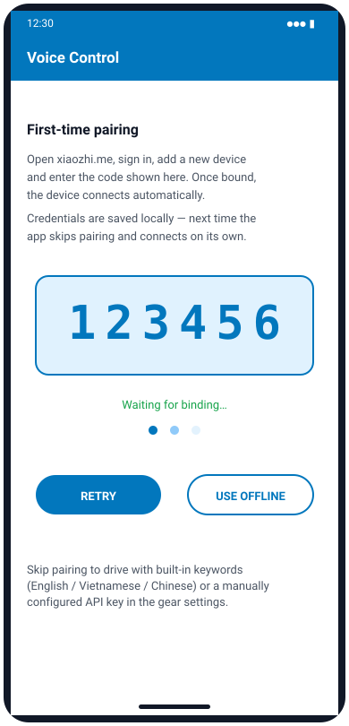
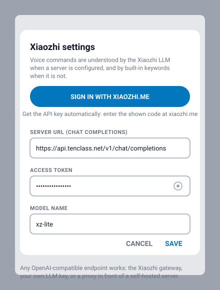

# 3 · FriendBot Android app

*Source: [`robot/android/`](../robot/android/) — mainly `app/src/main/java/org/openbot/app/robot/voice/` and `app/src/main/res/layout/fragment_voice_control.xml`. The app is the [OpenBot](https://www.openbot.org) robot app with FriendBot's Voice Control, Remote Mic and camera features added. Its package name is still `org.openbot.app.robot` so it builds the same way as upstream.*

## Install

### Option A — download the APK (easiest)

1. On the phone, open **[apk/FriendBot-android-debug.apk](../apk/FriendBot-android-debug.apk)** on GitHub and tap **Download raw file** (65 MB).
2. Open it. Android asks to allow *"install unknown apps"* for your browser/Files app → allow → **Install**.
3. The app appears as **FriendBot**.

*Why "debug":* it is signed with a development key, which is fine for your own phones but not for Google Play. *Example:* if you later install a build signed with another key, Android asks you to uninstall this one first.

Needs Android **7.0 or newer** (minSdk 24).

### Option B — build it yourself

1. Install **Android Studio** (recent version, JDK 17).
2. **File → Open →** `robot/android`. Wait for Gradle sync — it downloads the AI models (`download.gradle`) and the `comlib` libraries automatically.
3. Plug in the phone with **USB debugging** on → choose the **robot** run configuration → ▶ **Run**.
4. Or make an APK: **Build → Build APK(s)** → `app/build/outputs/apk/debug/robot-debug.apk`.

`google-services.json` in the project is a **placeholder** (dummy key). Everything in this guide works without Firebase; only Google sign-in / Google Drive projects need your own Firebase file.

## Connect the robot

| Link | How | When to use |
|---|---|---|
| **USB cable** | USB-C OTG cable from the phone to the ESP32's USB port → home screen **Robot Info** → turn **USB** on (115200 baud) | most reliable; the phone also powers the ESP32; Android sends a heartbeat (`h750`) so the robot stops if the app freezes |
| **Bluetooth LE** | home screen **Bluetooth** → tap **`FriendBot: MTV`** | no cable; the phone can sit anywhere on the robot |

*Check:* the robot's LCD shows `USB` or ` BLE` at the end of the first line, and Voice Control shows **"Connected (USB)"** or **"Connected (BLE)"**.

## Use Voice Control

**Home grid → General → Voice Control.** Allow the **microphone** when asked (the camera is asked the first time the assistant takes a photo).

### First launch: pair with Xiaozhi (once)

1. The app registers itself as a Xiaozhi device (`https://api.tenclass.net/xiaozhi/ota/`) and shows a **6-digit code**.
2. On any computer or phone, open **[xiaozhi.me](https://xiaozhi.me)** → sign in → **Add device** → type the code.
3. The app sees the binding, saves the credentials and connects. **Next time it connects by itself.**

**Use offline mode** skips pairing: you can still drive with the quick buttons and the built-in keywords.

### Talking to the robot

| You do | What happens |
|---|---|
| Just speak (hands-free, default) | the face turns blue (**Listening…**), Xiaozhi detects the end of your sentence, shows **Thinking…**, then answers in its voice (**Speaking…**) |
| Tap **Push to speak** | tap the mic to start, tap again to send |
| Tap the mic while Xiaozhi talks | interrupts the reply (barge-in) and listens again |
| Type a command + ➤ | same AI; offline it uses the keywords below |
| Quick buttons / Stop | drive directly, always work, no internet needed |
| Speed slider | 25–100 %, default 75 %; "faster"/"slower" change it by 15 % |
| Tap the camera corner | takes a photo; Xiaozhi describes what it sees |

*Example conversation:*
- You: **"đi thẳng 3 giây"** → Xiaozhi: "Được, đang đi thẳng!" + chip **» Move forward** → app sends `c144,144` every 250 ms for 3 s, then `c0,0`.
- You: **"what is in front of you?"** → chip **» Take a photo** → Xiaozhi: "I see a chair about one metre ahead."

### Built-in keywords (offline and safety net)

| English | Tiếng Việt | 中文 | Action |
|---|---|---|---|
| stop, halt | dừng, dừng lại, đứng lại | 停, 停止, 别动 | Stop (wins over everything) |
| back, reverse, go back | lùi, lùi lại | 后退, 倒, 向后 | Backward |
| left, turn left | trái, rẽ trái | 左, 左转 | Spin left |
| right, turn right | phải, rẽ phải | 右, 右转 | Spin right |
| faster, speed up | nhanh, tăng tốc | 快, 加速 | Speed +15 % |
| slower, slow down | chậm, giảm tốc | 慢, 减速 | Speed −15 % |
| forward, go, straight | tiến, đi | 前进, 向前, 走 | Forward |

*Source:* `VoiceInterpreter.java`. *Why "stop" is checked first:* "đừng đi" / "don't go" contains "go", but must not drive.

### Settings (gear)

Sign in again, choose the **voice language** (default Tiếng Việt), or set your own OpenAI-compatible server URL, token and model for typed commands when the live session is offline.

## Several phones, one robot

* The phone with the USB/Bluetooth link **shares the robot over Wi-Fi** as soon as its Voice Control page is open ("Connected (USB) · Sharing over WiFi").
* Another phone on the same Wi-Fi opens Voice Control → it shows **"Controlling via <phone> (WiFi)"** and drives through the host.
* **Remote Mic** (home grid) turns a second phone into a wireless microphone for the host's Xiaozhi session — no pairing needed on that phone.
* A **Stop** from any phone stops the robot for everyone.

## Safety in the app

* Every move ends by itself after its duration (default 1.2 s, max 8 s).
* Unknown words → **stop**, never guess.
* Unknown or malformed AI tool calls are rejected.
* Leaving the Voice Control screen stops the motors.
* The firmware adds its own sonar stop and failsafes ([Firmware](FIRMWARE.md)).

## Troubleshooting

| Problem | Fix |
|---|---|
| "Robot not connected" | connect USB (Robot Info → USB) or Bluetooth `FriendBot: MTV` first |
| USB not detected | use a real OTG data cable; some cables only charge |
| Pairing code not accepted | type it at xiaozhi.me while it is still on screen; tap **Retry** for a new one |
| "Xiaozhi offline" | the phone needs internet; reopen the screen or sign in again from the gear |
| The AI talks but the robot does not move | say a clear command ("go forward"), or check the link line |
| Robot stops after ~0.75 s over USB | the app froze or the cable is loose (heartbeat failsafe) |
| Camera corner hidden | allow the camera permission in Android Settings → Apps → FriendBot |

## Questions to go deeper

1. Why does the app re-send the same drive command every 250 ms instead of sending it once?
2. Why does the speech recognition happen on the Xiaozhi server and not with Google's on-phone recognizer? What do you gain and lose?
3. If two phones send different commands at the same moment, which one wins, and why is "Stop from any phone stops everyone" the safe rule?
4. How would you add a new voice tool such as `self.robot.lights` that sends the firmware's `i<left>,<right>` message?
5. What would you need to change to publish this app on Google Play (signing key, package name, privacy policy for microphone and camera)?
