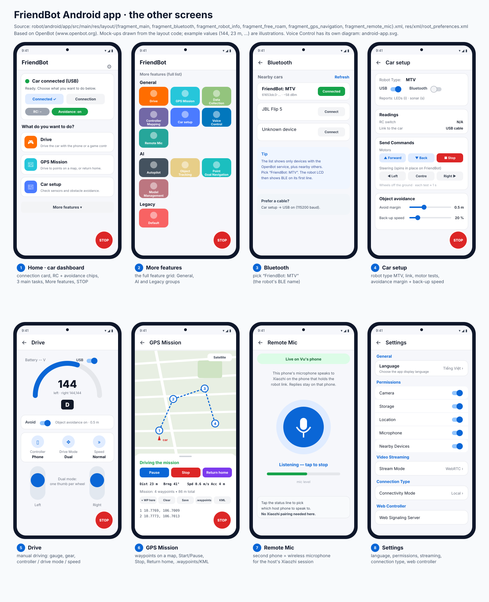
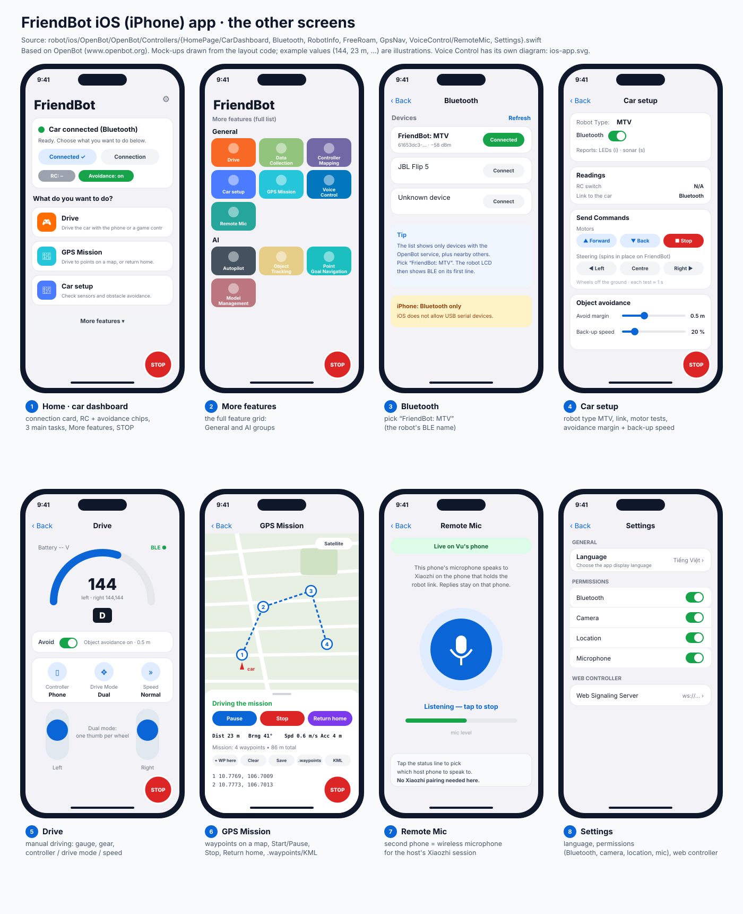

# 6 · The other app screens (Android and iOS)

Voice Control has its own guides ([Android](ANDROID_APP.md), [iOS](IOS_APP.md), [xiaozhi.me pairing](XIAOZHI_PAIRING.md)). This page covers **every other screen** you use with FriendBot. Both apps have the same screens. The differences are marked **Android** or **iOS**.

*Source:* Android layouts in `robot/android/app/src/main/res/layout/` and the feature list in `common/FeatureList.java`. iOS screens in `robot/ios/OpenBot/OpenBot/Controllers/` and the feature grid in `Utils/Constants.swift`. The screens come from [OpenBot](https://www.openbot.org) and were reworked for FriendBot (the dashboard, the STOP button, GPS Mission, Voice Control and Remote Mic).

| Android | iOS |
|---|---|
|  |  |

*The diagrams are drawn from the layout code. Numbers such as `144` or `23 m` are example values.*

---

## The STOP button (on every screen)

A big red **STOP** floats on every screen while the robot is connected. Tap it and **every** drive command becomes `c0,0`, whatever screen or voice command sent it. Tap **RESUME** to drive again.

*Source:* `EmergencyStop` in `CarDashboard.swift` (iOS) and `vehicle/EmergencyStop.java` + `main/StopButtonView.java` (Android). *Why one global button:* in a hurry you should never need to find "the right" stop for the current mode. *Example:* a GPS mission is running, a child walks in front, you tap STOP and the robot stops at once. The mission does not continue until you tap RESUME.

## 1 · Home (car dashboard)

What you see first. It answers one question: **is the robot ready?**

| Part | Meaning | Example |
|---|---|---|
| Status card | green dot + "Car connected (USB)" or "(Bluetooth)", or "Car not connected" with a hint | iPhone: "Turn on the car, then tap Connect and pick it from the list" |
| **Connect** / **Connection** | connect now / choose USB or Bluetooth | |
| Chips | **RC:** shows the RC switch (FriendBot has no RC receiver, so "RC: –"); **Avoidance: on/off** | |
| 3 task tiles | **Drive**, **GPS Mission**, **Car setup** | |
| **More features** | opens the full grid (screen 2) | |

*Why a dashboard instead of the original OpenBot grid:* most of the time you only need these three tasks, and the status card tells you at once why something does not move.

## 2 · More features

The full feature grid:

* **General:** Drive, GPS Mission, Data Collection, Controller Mapping, Car setup, **Voice Control**, **Remote Mic**
* **AI:** Autopilot, Object Tracking, Point Goal Navigation, Model Management
* **Legacy** (Android only): Default, the original OpenBot screen

The AI features are OpenBot's camera neural networks. *Example:* **Object Tracking** with class "person" makes FriendBot follow you using the phone's back camera. The firmware still stops for obstacles.

## 3 · Bluetooth

Lists nearby Bluetooth LE devices. Tap **Connect** next to **`FriendBot: MTV`**. The robot's LCD then shows ` BLE` at the end of its first line.

* **Android:** you can also use a USB cable instead (Car setup → USB).
* **iOS:** Bluetooth is the only link, because iOS does not let apps use USB serial devices.

*Why the name says "MTV":* it is the robot type the firmware reports (`ROBOT_TYPE`). The apps use it to enable the right features.

## 4 · Car setup

| Section | What it does | Example |
|---|---|---|
| Robot Type | the type the firmware reported | `MTV` |
| USB / Bluetooth toggles | **Android:** USB (115200 baud) or Bluetooth; **iOS:** Bluetooth | |
| Readings | RC switch (N/A on FriendBot), link to the car | "USB cable" |
| Send Commands → Motors | **Forward / Back / Stop** for about 1 s | wheels off the ground: both turn forward → wiring is right |
| Send Commands → Steering | **Left / Centre / Right**. On FriendBot these **spin in place** (tank mix), because it has no steering servo | Left → left wheel back, right wheel forward |
| Object avoidance | **Avoid margin** (how far to stop from an obstacle) and **Back-up speed** | margin 0.5 m |

*Why test here first:* if Forward makes one wheel go backwards, fix it now (`MOTOR_L/R_REVERSED`, see [Firmware](FIRMWARE.md)) before you trust voice or missions.

## 5 · Drive (manual)

* **Gauge:** the drive value sent to the robot (0–255) and the gear **D / R / P**.
* **Avoid** toggle: the app's object-avoidance gate. The firmware's own sonar stop is **always** active as well.
* **Controller:** **Phone** (on-screen) or **Gamepad** (Bluetooth game controller), or Web.
* **Drive Mode:** **Dual** (one thumb per wheel, the natural mode for FriendBot), **Game**, **Joystick**, **Tilt** (tilt the phone, 4° dead zone).
* **Speed:** **Slow / Normal / Fast** = full stick sends 128 / 192 / 255 (*source:* `Enums.SpeedMode`).

*Example:* Normal speed, both thumbs fully up → `c192,192`; with a box 30 cm ahead the firmware reduces it to about `c82,82`.

## 6 · GPS Mission

Mission Planner-style waypoint driving with the **phone's GPS** (no external GPS needed).

| Control | Meaning |
|---|---|
| Tap the map / **+ WP here** | add a waypoint (numbered 1, 2, 3…) |
| **Start / Pause / Stop** | run, pause or end the mission |
| **Return home** | drive back to where the mission started (RTL) |
| HUD **Dist / Brng / Spd / Acc** | distance and bearing to the next waypoint, speed, GPS accuracy |
| **Save · .waypoints · KML** | save; open/share Mission Planner `.waypoints` files; export a KML track for Google Earth |
| Satellite | switch map type |

Rules from `robot/README.md`: a waypoint counts as reached within **4 m**, and the mission **holds** if GPS accuracy is worse than 15 m or no fix for 3 s. *Example:* a 4-point loop in a park, 86 m total, waypoints at least 10 m apart.

*Why this needs open sky:* phone GPS is only good to about 3–5 m, so on a small indoor robot this screen is for outdoor tests.

## 7 · Remote Mic

Turns a **second phone** into a wireless microphone for the phone that holds the robot link.

1. Host phone: open **Voice Control** (it starts sharing over Wi-Fi).
2. Second phone, same Wi-Fi: open **Remote Mic** and tap the microphone.
3. The status shows **"Live on <host phone>"**. Speak: the host's Xiaozhi hears you, and replies play on the host.

No Xiaozhi pairing is needed on the second phone. **iOS** asks for *Local Network* permission the first time.

## 8 · Settings

| Android | iOS |
|---|---|
| Language · Permissions (Camera, Storage, Location, Microphone, Nearby Devices) · Video Streaming (Stream Mode) · Connection Type · Web Controller (signaling server) | Language · Permissions (Bluetooth, Camera, Location, Microphone) · Web Controller |

*Tip:* if Voice Control cannot hear you or the camera corner is hidden, check **Microphone** and **Camera** here first.

---

## Questions to go deeper

1. Why does FriendBot's "Steering" test spin the robot instead of turning gently like a car? What hardware would change that?
2. **Dual** vs **Game** drive mode: which is easier for a beginner, and which gives finer control of a differential-drive robot? Why?
3. The app has its own avoidance gate *and* the firmware has sonar safety. What happens if they disagree, and which one should win?
4. GPS Mission counts a waypoint as reached within 4 m. What goes wrong if you set it to 1 m with a phone GPS?
5. How could **Object Tracking** and **Voice Control** work together, for example "follow me" as a new Xiaozhi tool?
