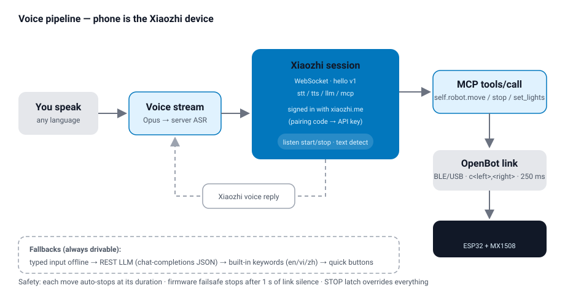
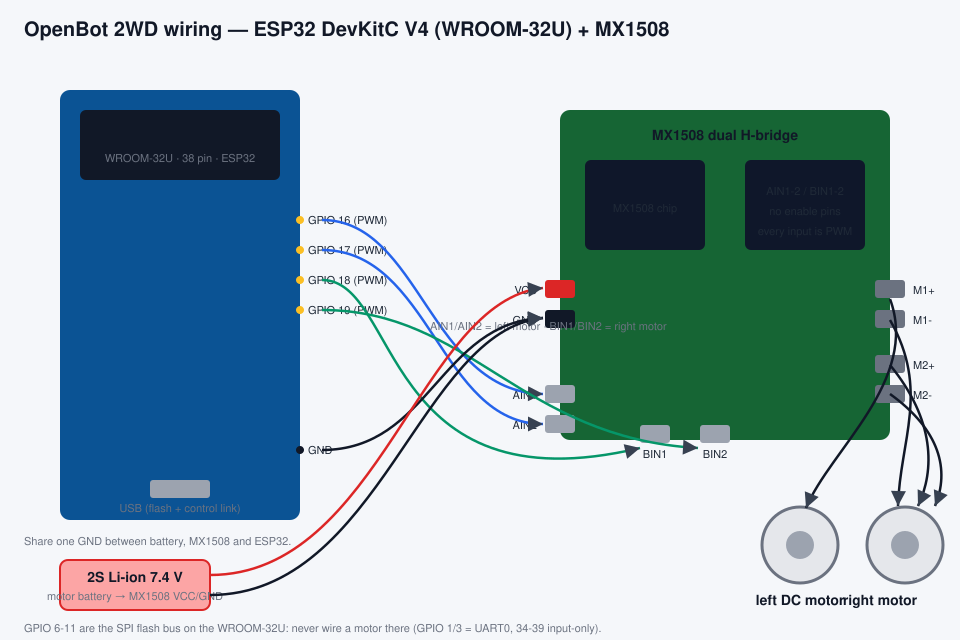
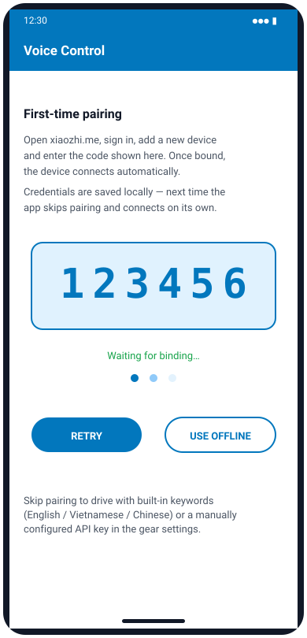
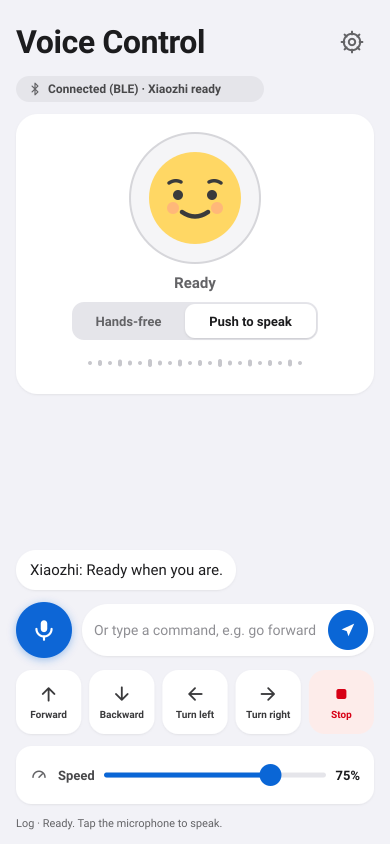
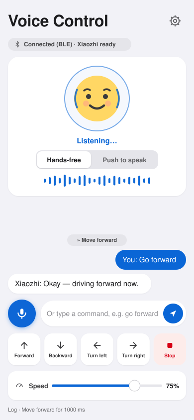
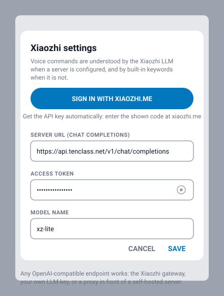

# OpenBot 2WD (ESP32 + MX1508) with Xiaozhi Voice Control

This guide covers the two-wheel OpenBot built in this repository: an **ESP32 WROOM-32U
DevKitC V4 (38 pin)** running the rewritten `firmware/openbot-esp32s3` firmware, driven by
DC motors through an **MX1508** dual H-bridge, and controlled **by voice** from the OpenBot
phone apps (**Android** and **iOS**) with the **Xiaozhi** language model as the brain.
The same firmware also builds for the ESP32-S3-DevKitC-1 (N16R8) — set `OPENBOT_BOARD`.

The **Xiaozhi agent** does the listening and the talking: the phone streams your voice to the
Xiaozhi server, which transcribes it, thinks, answers in its own synthesized voice, and — when
the robot should act — calls a robot tool. The phone plays that voice back and keeps the whole
exchange visible in a conversation list. The robot itself only drives — no microphone, no
speaker, no sonar, no LEDs, no LiDAR on board.

---

## 1. How voice control works



1. **First launch pairs the phone with xiaozhi.me** — the app registers as a Xiaozhi device,
   shows a verification code, and receives its API credentials back once you enter the code on
   the website. They are saved locally; later launches skip pairing and connect on their own.
2. **You speak** in your own language ("go forward", "tiến", "前进", "turn left"…) — tap the
   microphone and your voice streams to Xiaozhi as Opus audio; the server transcribes it
   (no Google or Apple speech is used).
3. **The Xiaozhi session answers.** The app holds a real XiaoZhi WebSocket session
   (hello v1, binary Opus audio both ways, `stt` / `tts` / `llm` / `mcp` messages). The
   assistant replies in speech and — when the robot should act — sends an **MCP tool call**
   (`self.robot.move`, `self.robot.stop`).
   * For typed input when the session is offline, a REST LLM call (chat-completions JSON)
     takes over, and as a last resort a built-in keyword interpreter
     (English / Vietnamese / Chinese) — the robot is always drivable.
4. **The app drives the robot** over the normal OpenBot link (BLE or USB serial) using the
   standard `c<left>,<right>` protocol, re-sent every 250 ms while a move runs.
5. **The assistant's reply is spoken in Xiaozhi's own voice** — the server's synthesized
   speech streams back and the phone plays it — and the whole exchange appears in the
   on-screen conversation transcript.

Safety is layered: each move auto-stops after its duration (300–8000 ms), the firmware stops
after 1 s of link silence (`CONTROL_TIMEOUT_MS`), the app's red STOP latch overrides every
command, and an object-avoidance gate filters all drive values before they reach the wire.

---

## 2. Hardware

### Parts

| Part | Notes |
|---|---|
| ESP32 **WROOM-32U DevKitC V4**, 38 pin | classic ESP32; the ESP32-S3-DevKitC-1 (N16R8) works too |
| MX1508 dual H-bridge module | one PWM input per direction, no enable pins |
| 2× DC gear motors + wheels | differential drive |
| 2S Li-ion battery (7.4 V) | motor supply → MX1508 `VCC` terminal |
| USB cable | flashing, and optional wired control link |

### Wiring



| Signal | ESP32 GPIO | MX1508 pin |
|---|---|---|
| Left motor forward (PWM, 5 kHz) | **16** | AIN1 |
| Left motor backward (PWM, 5 kHz) | **17** | AIN2 |
| Right motor forward (PWM, 5 kHz) | **18** | BIN1 |
| Right motor backward (PWM, 5 kHz) | **19** | BIN2 |

Notes:

* **Common ground**: battery −, MX1508 GND and ESP32 GND must be connected together.
* **Motor power**: the battery feeds the MX1508 `VCC` terminal — never take motor power
  from the ESP32's 3V3/5V pin.
* **No enable pins**: every MX1508 input is a PWM speed pin (one per direction); forward is
  `AIN1`-high duty + `AIN2` low, backward the other way round.
* **Do not wire anything to GPIO 6–11** — they are the SPI flash bus on the WROOM-32U and
  using one crashes the board (the MX1508 test sketch's `ForwardPin 6` lives there). Also
  avoid GPIO 1/3 (UART0) and 34–39 (input-only). On the ESP32-S3 build the reserved pins
  are 26–37, 0, 3, 45, 46, 19, 20, 43, 44 instead. The firmware keeps them all free.
* **Motor direction**: if a side runs backwards for "forward", flip that side's two motor
  wires — or set `MOTOR_L_REVERSED` / `MOTOR_R_REVERSED` in the firmware (see below).

---

## 3. Firmware (`firmware/openbot-esp32s3`)

The firmware is a rewrite for the 2WD MX1508 robot, based on the MTV `openbot.ino` base
code: its motor model (one PWM input per direction, 8-bit speed at 5 kHz, brake or coast on
stop) and its ESP32 BLE/serial protocol. It keeps the standard OpenBot line protocol (so
both phone apps work unmodified) and adds a text-command channel. It drives the motors and
nothing else.

### Settings to check before flashing

| Define | Default | Meaning |
|---|---|---|
| `OPENBOT_BOARD` | `OPENBOT_BOARD_ESP32` | the DevKitC V4; `OPENBOT_BOARD_ESP32S3` for the ESP32-S3 |
| `MOTOR_L_REVERSED` | `0` | `1` flips the left motor |
| `MOTOR_R_REVERSED` | `1` | `1` flips the right motor (your chassis may differ) |
| `MOTOR_PWM_FREQ` / `MOTOR_PWM_RES` | `5000` / `8` | 5 kHz, 8-bit duty (0–255) |
| `MOTOR_MAX_SPEED` | `110` | of 255 — full app speed maps to this duty (the MX1508 test sketch's `MaxSpeed`) |
| `MOTOR_MIN_DUTY` | `30` | of 255 — lifts the motors out of the dead band |
| `MOTOR_BRAKE_ON_STOP` | `1` | brake (both inputs high) instead of coast on stop |
| `CONTROL_TIMEOUT_MS` | `1000` | failsafe: stop after 1 s without commands |
| `VOICE_SPEED_DEFAULT` | `192` | full-scale drive value for text commands |
| `HAS_RC` | `0` | optional RC receiver (iBUS on GPIO 13, or GPIO 42 on the S3) |

### Build and flash

```bash
arduino-cli compile --fqbn esp32:esp32:esp32 firmware/openbot-esp32s3

arduino-cli upload --fqbn esp32:esp32:esp32 \
  --port /dev/tty.usbserial-0001 firmware/openbot-esp32s3
```

For the ESP32-S3 use `--fqbn esp32:esp32:esp32s3 --board-options
PSRAM=opi,FlashSize=16M,PartitionScheme=default` instead.

The board shows up in the apps as **"OpenBot"** over BLE (services
`61653dc3-…` / `06386c14-…` / `9bf1103b-…`) or as a USB serial device.

### Protocol (phone → robot)

| Message | Meaning |
|---|---|
| `c<left>,<right>` | drive, each −255…255 |
| `t<text>` | **voice/text command**: "go back", "stop", "转左", "tiến"… |
| `h<ms>` | heartbeat timeout (apps send 1000) |
| `f` | feature query → robot replies `f2WD_ESP32:` (or `f2WD_S3:` on the ESP32-S3 build) |

Robot → phone: `v` battery divider, `w` wheel RPM, `m` RC mode.

The `t` text channel understands the same vocabulary as the apps' offline interpreter:
**stop / back / left / right / faster / slower / forward** in English, Vietnamese and Chinese
("stop" wins over everything; "go back" reverses).

---

## 4. The Voice Control screen (Android & iOS)

The screen lives in the "General" section of the app grid as the **Voice Control** tile
(microphone icon). Native on both platforms:

* Android: `robot/android/.../robot/voice/` (`VoiceControlFragment` and friends),
  added to `nav_graph.xml` and the `FeatureList` registry.
* iOS: `robot/ios/OpenBot/OpenBot/Controllers/VoiceControl/` (`VoiceControlController`),
  pushed from the home grid like the other code-built screens.

### First launch: pair with xiaozhi.me



The first time you open Voice Control it walks you through device pairing — the same flow the
whisplay-xiaozhi and py-xiaozhi clients use:

1. The app registers itself with the Xiaozhi platform and shows a **verification code**.
2. Open **xiaozhi.me**, sign in, add a new device and enter the code.
3. Once bound, the device connects automatically. **Credentials are saved locally — next time
   you open the screen, pairing is skipped** and it connects on its own.

**Use offline** skips pairing and drives with the built-in keywords (or a manually configured
key, §5). The gear button can restart pairing later.

### The conversation screen

| Android | iOS |
|---|---|
|  |  |

The screen opens with a friendly **face** with the current state under it (**Ready** →
**Listening…** → **Thinking…** → **Speaking…**); sound arcs and a blue ring appear around the
face while the mic is live. Under it a live **waveform** follows your voice while listening and
the reply while speaking.

**Hands-free is the default** — just talk, like with the Lily voice agent: the robot keeps
listening (the Xiaozhi server detects when you finish a sentence), shows **Thinking…** while
it works, and answers in Xiaozhi's own voice, played by the phone. The **Push to speak**
toggle switches to tap-to-talk. Tapping the microphone while the assistant is speaking
**interrupts the reply** (barge-in) and starts listening again.

The transcript below is a chat: your turns bubble on the right, Xiaozhi's answers on the left, and
every robot action the assistant runs appears as a `» …` chip (for example `» Move forward`) —
so each request — for information or for an action — is answered by voice **and** kept visible
in the list.

Several phones can drive the same robot. The phone with the Bluetooth (or USB) link to the
robot shares it over WiFi as soon as you open the voice control page there — its connection
line reads "Connected (BLE) · Sharing over WiFi". Other phones on the same network find it
automatically: their line reads "Controlling via <phone> (WiFi)", and every voice command,
typed command and quick button on them drives the robot through that phone. A **Stop** from
any phone stops the robot for everyone.

**Tap the connection line** to choose which robot to drive: this phone's own Bluetooth (or
USB) link, or the robot a specific other phone shares — listed by phone name whenever more
than one is shared on the network. The choice is remembered the next time you open the page.

### Remote Mic: speak from a second phone

The **Remote Mic** page turns any other phone on the network into a wireless microphone for
the voice control page that holds the robot. Open the voice control page on the phone with
the robot link (the host), then open **Remote Mic** on the second phone, tap the microphone
and speak: your voice feeds the host's Xiaozhi session directly, so the second phone needs
no Xiaozhi pairing at all. The conversation and Xiaozhi's spoken replies stay on the host
phone — only the microphone travels over the network. The status line shows "Live on
<phone>" once the host's voice page is hearing you; if it says to open the voice control
page first, the host page is closed. Tap the status line to pick which shared robot (which
host phone) to speak to. The microphone stops whenever you leave the page.

### Seeing the environment: the phone camera

The assistant has eyes too — modeled on the Keyestudio KS5028 S3CAM camera firmware. Ask
it to see something ("what's in front of me?", "take a photo and tell me what you see",
 "có gì quanh đây?") and it calls the **photo tool**: the phone's camera takes one picture
of the environment, the picture and your question are uploaded to the **Xiaozhi vision
explain service** — the same service and wire format the KS5028 S3CAM firmware uses; the
server tells the app its URL and token when the assistant connects — and the answer is
spoken in Xiaozhi's own voice and kept in the conversation list (a `» Take a photo` chip
marks the look-around). The first capture asks for camera permission.

A live **camera preview** sits in the top-right corner of the page — the assistant's "eye".
The round button on it flips between the phone's **back and front cameras** (the choice is
remembered), and **tapping the preview** takes a photo right away and shows the vision
model's answer in the conversation. Every capture — yours or the tool's — flashes the
shutter still in the corner for a moment, so the taken picture is always visible. If camera
permission is declined the corner stays hidden and the photo tool asks again on demand.

| Input | What it does |
|---|---|
| **Microphone** | hands-free: just speak — or tap to talk / tap to end (Push to speak) |
| **Typed command** | same pipeline, e.g. type `go forward for a bit` |
| **Quick buttons** | Forward / Backward / Turn left / Turn right / Stop |
| **Speed slider** | rescales every move (25–100 %, default 75 %); "faster"/"slower" adjust it too |
| **Settings gear** | pairing / Xiaozhi API configuration (see §5) |

### How one utterance is handled

1. Your voice streams into the live **Xiaozhi WebSocket session** as Opus audio (typed text is
   sent as a text message instead).
2. The server transcribes it (a `You:` bubble appears), the assistant answers — its synthesized
   speech streams back and plays on the phone, each sentence shown as a `Xiaozhi:` bubble — and
   any **MCP tool call** it issues moves the robot (listed as a `»` chip). If it only chats and
   your typed words clearly matched a drive command, the built-in interpreter still drives as
   a safety net.
3. Without a session, typed input falls back to the REST LLM brain and then to the built-in
   keywords (shown in the list, not spoken); the microphone reports that Xiaozhi is offline.
   The quick buttons always drive the robot.

Turns **spin in place** (left motor reverse, right motor forward for "turn left"). A move runs
for its duration and then stops by itself; the drive values are re-sent every 250 ms so the
firmware's heartbeat failsafe never cuts a move short. Leaving the screen stops the robot.

### Command vocabulary (spoken through Xiaozhi, typed, and offline)

| English | Tiếng Việt | 中文 | Action |
|---|---|---|---|
| forward, go, ahead, straight | tiến, đi | 前进, 向前, 走 | Forward |
| back, reverse, go back | lùi, lùi lại | 后退, 倒, 向后 | Backward |
| left, turn left | trái, rẽ trái | 左, 左转 | Turn left |
| right, turn right | phải, rẽ phải | 右, 右转 | Turn right |
| stop, halt | dừng, dừng lại | 停, 停止 | Stop |
| faster, speed up | nhanh, tăng tốc | 快, 加速 | Speed +15 % |
| slower, slow down | chậm, giảm tốc | 慢, 减速 | Speed −15 % |
| lights on, turn on the light | bật đèn, mở đèn | 开灯 | Lights on |
| lights off, turn off the light | tắt đèn | 关灯 | Lights off |
| signal left, left indicator | xi nhan trái | 左转向灯 | Left signal blinking |
| signal right, right indicator | xi nhan phải | 右转向灯 | Right signal blinking |
| hazard, hazard lights | đèn hazard | 危险灯 | Both signals blinking |
| signals off, indicators off | tắt xi nhan | 关转向灯 | Signals off |
| sonar, distance, how far | khoảng cách | 距离, 超声波 | Read sonar distance |
| sing, song | hát | 唱歌 | Sing and turn around |
| triangle | tam giác | 三角形 | Drive a triangle |
| circle | vòng tròn, hình tròn | 圆形, 圆圈 | Drive a circle |
| spin, 360 | xoay, một vòng | 旋转, 转一圈 | Spin 360° in place |
| turn around | quay lại, quay đầu | 掉头, 转身 | Turn 180° in place |
| left and right | trái phải | 左右 | Turn left and right |
| go forward 5 seconds / 3000 ms | tiến 5 giây | 走5秒 | Move for the spoken duration (up to 15 s) |

With the Xiaozhi LLM configured, anything else works too ("drive backwards slowly for three
seconds", "quay phải") — the model picks the action, speed and duration.

---

## 5. Configuring Xiaozhi

Tap the gear on the Voice Control screen:



### Sign in with xiaozhi.me (gets the API key for you)

Pairing normally happens on first launch (§4). The gear's **Sign in with xiaozhi.me** button
re-runs the same device-pairing flow of the
[whisplay-xiaozhi](https://github.com/PiSugar/whisplay-xiaozhi) project any time you need it —
the app registers as a Xiaozhi device and the platform issues the key back automatically.

1. Tap **Sign in with xiaozhi.me**. The app contacts the Xiaozhi OTA endpoint
   (`https://api.tenclass.net/xiaozhi/ota/`) and shows a **verification code**.
2. Open **xiaozhi.me** in a browser, sign in, add a device and enter the code.
3. The app polls the same endpoint, detects the binding, and saves the issued **API key** and
   WebSocket credentials — the token field is filled in and ready to use.

The phone keeps its device identity (device id, client id, HMAC fingerprint) after the first
login, so a later sign-in jumps straight to the verification-code step. Manual configuration
below remains available as an override.

### Manual configuration

| Field | Value |
|---|---|
| **Server URL** | any OpenAI-compatible *chat completions* endpoint. Default: `https://api.tenclass.net/v1/chat/completions` (the Xiaozhi gateway behind xiaozhi.me). Your own OpenAI/DeepSeek/… URL works as well, or a proxy in front of a self-hosted `xiaozhi-esp32-server`. |
| **Access token** | the `Authorization: Bearer …` key for that endpoint (filled in automatically by **Sign in with xiaozhi.me**). Leave empty to use only the built-in keywords. |
| **Model name** | default `xz-lite`; the gateway also offers `qwen`, `deepseek`, `gpt-5`, `doubao`, … Use whatever your endpoint serves. |

The app sends one system prompt (robot description + JSON-only answer rule) plus the recent
conversation turns, and expects exactly:

```json
{"action": "forward | backward | left | right | stop | none | lights_on | lights_off | indicator_left | indicator_right | indicator_hazard | indicator_off | sonar | sing | triangle | circle | spin | turn_around | wiggle",
 "speed": 0.15-1.0,
 "duration_ms": 300-15000,
 "say": "short spoken reply in the user's language"}
```

`"none"` means pure conversation — the assistant just talks, no movement. The parser tolerates
code fences and stray prose around the object. If the server errors or the reply is not
understood, the screen logs it and falls back to the built-in keywords.

---

## 6. Safety behavior

* Every move **auto-stops** at its duration (default 1.2 s, max 15 s).
* The **Tilt** drive mode has a 4° dead zone and stops the moment the phone is level.
* The firmware **failsafes** to stop after 1 s without commands.
* The app-wide red **STOP latch** (car dashboard) overrides every command until resumed.
* The **object-avoidance gate** filters all drive commands when proximity data is available.
* **Unknown words stop** the robot (both offline and when the LLM is unsure).
* Tapping the microphone while the assistant speaks **interrupts the reply** (barge-in: the
  phone stops playback and sends `abort` to the server).
* Unknown or malformed **MCP tool calls are rejected**, never executed.
* Closing/navigating away from the screen **stops the motors** immediately.

---

## 7. Troubleshooting

| Symptom | Fix |
|---|---|
| Robot doesn't spin, just hums | raise `MOTOR_MIN_DUTY`, or check the motor battery under load |
| Robot drives the wrong way | set `MOTOR_R_REVERSED`/`MOTOR_L_REVERSED` to `1`/`0`, or swap that side's two wires |
| "Robot not connected" on the screen | connect BLE ("OpenBot") from the app's Bluetooth screen first |
| Nothing heard / no answer to voice | grant the microphone permission; voice goes through Xiaozhi, so the phone needs Wi-Fi or mobile data |
| Assistant cannot see / photo tool fails | grant the camera permission; the explain URL + token arrive from the server at connect (reconnect the assistant if the tool answers "Image explain URL or token is not set"); "Failed to upload photo" means the vision service refused the picture |
| Hands-free never listens | toggle **Push to speak** off/on or reopen the screen; the face ring turns blue when the mic is live |
| The robot answers in the wrong language | pick the language in the gear's **Voice language** (affects typed/REST fallbacks); spoken replies follow the Xiaozhi server |
| Pairing code never accepted | enter it at xiaozhi.me while the code is on screen (tap **Retry** if it expired) |
| "Xiaozhi ready" never appears | credentials may be stale — run **Sign in with xiaozhi.me** again from the gear |
| Assistant chats but the robot stays still | phrase a clear drive command ("go forward"), or use the quick buttons |
| Xiaozhi errors in the log | check the endpoint URL and token; leave the token empty to fall back to keywords |
| Move stops early | something is re-sending `c0,0` (STOP latch) or the link dropped for >1 s |
