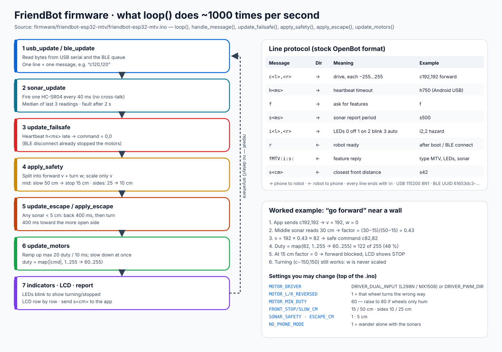

# 2 · FriendBot firmware (`firmware/friendbot-esp32-mtv`)



*Source: [`friendbot-esp32-mtv.ino`](../firmware/friendbot-esp32-mtv/friendbot-esp32-mtv.ino). It is a rewrite of the OpenBot "MTV" sketch from [OpenBot](https://www.openbot.org) (`firmware/openbot/openbot.ino` in the original repo). It speaks the same line protocol, so every OpenBot feature in the apps still works.*

## What the firmware does — in one sentence

It **receives drive commands** from the phone (USB or Bluetooth), **checks them against the three sonars**, and **turns the motors** — while making sure the robot stops if the phone goes silent or a wall gets too close.

## Flash it

1. Install **Arduino IDE 2** and the **esp32 by Espressif** boards package (core 2.x or 3.x both work — *source:* `CORE_V3` switch at the top of the sketch).
2. **Tools → Board → ESP32 Dev Module.**
3. **Tools → Manage Libraries →** install **LiquidCrystal I2C** (by Frank de Brabander). *NewPing is not needed any more.*
4. Open `firmware/friendbot-esp32-mtv/friendbot-esp32-mtv.ino` → **Upload**.
5. Check: the LCD shows `FriendBot MTV` then `Ready  BLE+USB`, and phones can see the Bluetooth device **`FriendBot: MTV`**.

Command line alternative:

```bash
arduino-cli lib install "LiquidCrystal I2C"
arduino-cli compile --fqbn esp32:esp32:esp32 firmware/friendbot-esp32-mtv
arduino-cli upload  --fqbn esp32:esp32:esp32 -p /dev/tty.usbserial-0001 firmware/friendbot-esp32-mtv
```

*If upload fails with "Failed to connect":* hold the **BOOT** button while "Connecting…" is shown, or unplug the middle sonar (GPIO 12, a strapping pin — see [Wiring](WIRING.md#four-rules-that-prevent-most-problems)).

## Settings (top of the sketch)

| Setting | Default | What it does | Example / when to change |
|---|---|---|---|
| `ROBOT_TYPE` | `"MTV"` | name the apps receive in the feature reply | keep `MTV` — the apps use it to pick the right features |
| `HAS_BLUETOOTH` / `HAS_LCD` / `HAS_SONAR` / `HAS_INDICATORS` | 1 | turn parts on/off | no LCD fitted → `HAS_LCD 0` |
| `SONAR_SAFETY` | 1 | firmware slows/stops before obstacles | set 0 only for bench tests |
| `NO_PHONE_MODE` | 0 | 1 = drive alone and steer away from walls | a demo without a phone |
| `MOTOR_DRIVER` | `DRIVER_DUAL_INPUT` | L298N / MX1508 style (PWM on IN1 or IN2) | Cytron MDD10A → `DRIVER_PWM_DIR` |
| `MOTOR_L_REVERSED` / `MOTOR_R_REVERSED` | 0 / 0 | flip one wheel | right wheel spins backward on "forward" → `MOTOR_R_REVERSED 1` |
| `MOTOR_MIN_DUTY` | 60 | smallest PWM that really turns the wheels | wheels only hum at low speed → 80 |
| `MOTOR_MAX_DUTY` | 255 | PWM at full app speed | robot too fast → 200 |
| `MOTOR_BRAKE_ON_STOP` | 0 | 1 = brake, 0 = coast | stops too slowly on a slope → 1 |
| `MOTOR_RAMP_STEP` | 20 | max PWM increase per 10 ms | wheels spin on a smooth floor → 10 |
| `FRONT_STOP_CM` / `FRONT_SLOW_CM` | 15 / 50 | middle sonar stop / start-slowing distance | |
| `SIDE_STOP_CM` / `SIDE_SLOW_CM` | 10 / 25 | same for left/right sonars | narrow corridors → 6 / 15 |
| `ESCAPE_CM` | 5 | closer than this → back up and turn | |
| `CONTROL_TIMEOUT_MS` | 0 (off) | stop if no `c` command for this long | the Voice Control screen re-sends every 250 ms, so 1000 is safe with it |

## 1. Messages from the phone

The firmware reads one text line at a time (ending with `\n`) from **USB serial (115200 baud)** and from **Bluetooth LE** (service `61653dc3-4021-4d1e-ba83-8b4eec61d613`, same UUIDs as stock OpenBot). USB and BLE each have their own buffer, so they never mix up each other's messages.

| Message | Meaning | Example |
|---|---|---|
| `c<left>,<right>` | drive, each −255…255 | `c192,192` forward · `c-150,150` spin left |
| `h<ms>` | heartbeat: stop if the next message is later than this | Android over USB sends `h750` every 250 ms |
| `f` | "what can you do?" → robot answers `fMTV:i:s:` | |
| `s<ms>` | how often to send the sonar distance | `s500` |
| `i<left>,<right>` | LEDs: 0 off, 1 on, 2 blink, 3 auto | `i2,2` = hazard lights |

The robot sends back `r` (ready, after boot and after a Bluetooth connect) and `s<cm>` (closest of the three front distances). Broken or too-long lines are dropped, never half-executed. *Why:* a cut-off `c25` from `c255,255` must not become "left wheel 25, right wheel unchanged".

## 2. Sonars without blocking

The old OpenBot MTV sketch waited for each echo with `delay()` and `ping_cm()`, so the robot was "deaf" to the phone for up to 200 ms per loop. FriendBot fires **one sonar every 40 ms** and measures the echo with an **interrupt**, then takes the **median of the last 3** readings.

*Example:* readings 82, 81, 7 (a false echo) → median **81**, so one glitch does not stop the robot. *Why one at a time:* two sonars firing together hear each other's ping.

## 3. Failsafes

| Situation | What happens | Source |
|---|---|---|
| Bluetooth disconnects while BLE was driving | motors stop at once | `ble_update()` → `stop_now()` |
| Heartbeat `h<ms>` not renewed in time (Android USB) | command becomes 0,0 | `update_failsafe()` |
| Sonar wire broken (no echo edges for 2 s) | that sonar is ignored, LCD shows `---` | `sonar_finish()` |
| No LCD found at 0x27 or 0x3F | robot runs without LCD | `lcd_begin()` |

## 4. The safety layers

`apply_safety()` splits every command into **forward speed v = (left+right)/2** and **turn w = (left−right)/2**, and scales only **v** by the sonar distance:

```
factor = (distance − STOP) / (SLOW − STOP)     clamped to 0…1
```

*Example:* "go forward" (`c192,192`) with a box 30 cm ahead → factor (30−15)/(50−15) = 0.43 → `c82,82`. At 15 cm the factor is 0 and the LCD shows `STOP`.

*Why only v:* if the turn were also scaled, a robot facing a wall could never turn away from it. Turning on the spot and reversing always work.

`apply_escape()` is the last resort: if anything is **closer than 5 cm**, the robot backs up for 400 ms, then turns 400 ms toward the side with more room, and repeats until the front is clear — even if the app still says "forward".

## 5. Motors

`update_motors()` ramps **up** gently (max +20 of 255 every 10 ms → 0 to full in about 130 ms) but slows **down instantly**. *Why:* gentle starts protect the gears and stop wheel-spin; instant stops are safer. When the direction changes, the motor passes through 0 first.

PWM = `map(|command|, 1…255 → MOTOR_MIN_DUTY…MOTOR_MAX_DUTY)` at 5 kHz, 8-bit. *Example:* `c82` → PWM 122 of 255 (48 %). *Why start at 60, not 0:* below ~60 the motor hums but does not move, so small app commands would do nothing.

## 6. LEDs and LCD

* **LEDs (auto mode):** left blinks = turning left, right blinks = turning right, both blink = stopped, both off = driving straight.
* **LCD**, updated one row every 125 ms, only the characters that changed (no flicker):

```
L 144 R 144  BLE     ← motor outputs and link: BLE / USB / WAIT / LOST / STOP
L 40 M120 Rmax       ← left / middle / right distance in cm (--- = sensor fault)
```

## Bench test (wheels off the ground)

1. Open **Serial Monitor**, 115200, line ending "Newline".
2. Type `c150,150` → both wheels forward. `c-150,-150` → both backward. `c0,0` → stop.
3. Type `h1000`, then `c150,150` and wait → the wheels stop after 1 s (heartbeat failsafe).
4. Type `c150,150` again and slowly move a hand toward the middle sonar → wheels slow from 50 cm and stop at 15 cm; at 5 cm the escape reflex reverses them.

## Questions to go deeper

1. Why is the escape reflex allowed to *override* the phone, while the slow-down only *scales* the phone's command?
2. The Android app sends a heartbeat over USB but neither app sends one over Bluetooth. Which failsafe covers Bluetooth instead, and what case does it not cover? (Hint: think about a frozen app with the Bluetooth link still up — and how `CONTROL_TIMEOUT_MS 1000` would fix it.)
3. Why is a median of 3 better than an average of 3 for sonar glitches?
4. What would you change so the robot slows down for an obstacle while *reversing*? (There is no rear sonar today.)
5. If you add wheel encoders, how could `update_motors()` make both wheels turn at exactly the same speed (closed-loop PID)?
