# 4 · FriendBot iOS (iPhone) app: complete guide to every screen

This guide covers the FriendBot iOS (iPhone) app from install to the last screen. **Every screen has its own picture** (SVG drawn from the app's layout code) and short steps, an example and, where useful, *why* it works that way. The app is based on [OpenBot](https://www.openbot.org); its code is in [`robot/ios/`](../robot/ios/).

> Comparing both apps side by side? See **[SCREENS_GUIDE.md](SCREENS_GUIDE.md)**. The other app's guide: **[Android](ANDROID_APP.md)**.

<p align="center">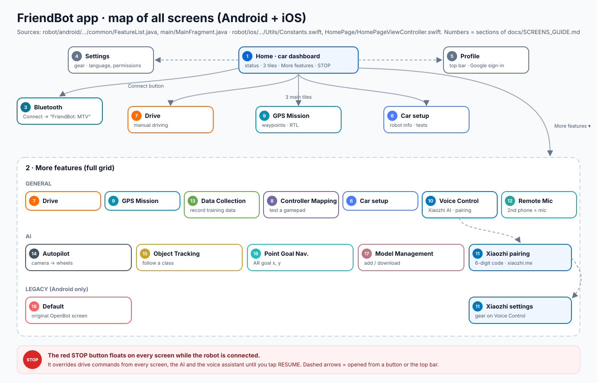</p>

## Contents

* [Install](#install-build-with-xcode)
* [Connect the robot](#connect-the-robot-bluetooth-only)
* [The STOP button](#the-stop-button-on-every-screen)
* **Getting started**
  1. [Home (car dashboard)](#1-home-car-dashboard)
  2. [More features](#2-more-features)
  3. [Bluetooth](#3-bluetooth)
  4. [Settings](#4-settings)
  5. [Profile (Google sign-in)](#5-profile-google-sign-in)
* **Driving**
  6. [Car setup](#6-car-setup)
  7. [Drive](#7-drive)
  8. [Controller Mapping](#8-controller-mapping)
  9. [GPS Mission](#9-gps-mission)
  10. [GPS Mission: tap menu](#10-gps-mission-tap-menu)
* **Voice**
  11. [Voice Control](#11-voice-control)
     * [Xiaozhi pairing and settings](#xiaozhi-pairing-and-settings)
  12. [Remote Mic](#12-remote-mic)
* **AI**
  13. [Data Collection](#13-data-collection)
  14. [Autopilot](#14-autopilot)
  15. [Object Tracking](#15-object-tracking)
  16. [Point Goal Navigation](#16-point-goal-navigation)
  17. [Model Management](#17-model-management)
  18. [Model Details (add your own model)](#18-model-details-add-your-own-model)
* [Several phones, one robot](#several-phones-one-robot)
* [Safety, layer by layer](#safety-layer-by-layer)
* [Troubleshooting](#troubleshooting)
* [Questions to go deeper](#questions-to-go-deeper)

## Install (build with Xcode)

Apple only allows installing iPhone apps from the App Store, TestFlight, or **your own Xcode build**. So you build it once on a Mac (about 15 minutes the first time).

**You need:** a Mac with **Xcode**, **CocoaPods**, an iPhone with **iOS 15+**, and a USB cable.

```bash
git clone https://github.com/quangvu16/FriendBot.git
cd FriendBot/robot/ios/OpenBot
pod install                     # libopus, Starscream, TensorFlowLiteSwift, …
open OpenBot.xcworkspace        # the .xcworkspace, not the .xcodeproj
```

1. Target **OpenBot** → **Signing & Capabilities** → **Team** = your Apple ID. If the bundle id `com.vunguyen.openbot.ackermann` is taken, change it, e.g. `com.<yourname>.friendbot`.
2. iPhone: **Settings → Privacy & Security → Developer Mode → On**.
3. Choose the iPhone in Xcode → ▶ **Run** → on the iPhone, trust the developer certificate (**Settings → General → VPN & Device Management**).

*Why the app stops opening after 7 days:* builds signed with a free Apple ID expire. Just press ▶ Run again.

## Connect the robot (Bluetooth only)

1. Switch the robot on. The LCD shows `FriendBot MTV`.
2. Home → **Connect** → **`FriendBot: MTV`**.
3. The LCD's first line ends with ` BLE`, and Home shows a green dot.

If Bluetooth drops, the firmware stops the motors at once.
*Why the firmware accepts "write" and "write without response":* iOS sends **Stop** *with* response and drive commands *without*.

## The STOP button (on every screen)

A red **STOP** floats on every screen while the robot is connected. It overrides every drive command (thumbs, GPS mission, AI, voice) until you tap **RESUME**. *Example:* a mission is running and a child walks in front → STOP → the robot stops at once, and the mission waits.

---

# Getting started

## 1 Home (car dashboard)

<p align="center">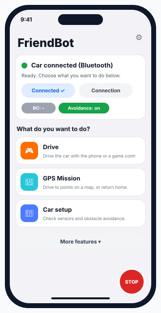</p>

The first screen after the app opens. It answers one question: **is the robot ready?**

* **Status card**: green dot + **"Car connected (Bluetooth)"**. Not connected: "Turn on the car, then tap Connect and pick it from the list."
* **Connect** opens the Bluetooth list.
* Chips: **RC** (FriendBot has no RC receiver, so "RC: –") and **Avoidance on/off**.
* Three task tiles: **Drive**, **GPS Mission**, **Car setup**. **More features ▾** opens every other screen.
* **Settings** and **Profile** buttons at the top.

*Example:* the card says "Car not connected" → tap **Connect** → pick `FriendBot: MTV` → green dot.

*Source (in `robot/ios/OpenBot/OpenBot/`):* `Controllers/HomePage/CarDashboard.swift`, `HomePageViewController.swift`

## 2 More features

<p align="center">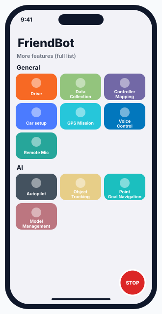</p>

The full grid of features:

* **General:** Drive · Data Collection · Controller Mapping · Car setup · GPS Mission · Voice Control · Remote Mic
* **AI:** Autopilot · Object Tracking · Point Goal Navigation · Model Management

(The Android app also has a "Legacy" group; the iOS app does not.)

*Example:* to make FriendBot follow you, open **More features → AI → Object Tracking**.

*Source (in `robot/ios/OpenBot/OpenBot/`):* `Utils/Constants.swift` (gameModes)

## 3 Bluetooth

<p align="center">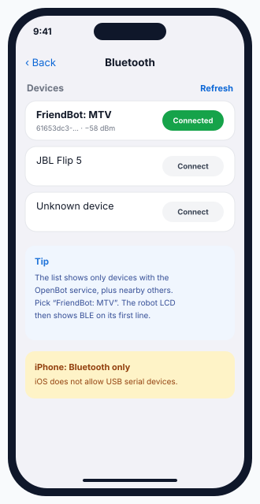</p>

Finds the robot over Bluetooth LE: tap **Connect** next to **`FriendBot: MTV`**. The robot's LCD then ends its first line with ` BLE`.

**Bluetooth is the only link on iPhone.** iOS does not allow apps to talk to USB serial devices such as the ESP32.

*Why the name says "MTV":* it is the robot type the firmware reports (`ROBOT_TYPE`), so the app enables the right features.

*Source (in `robot/ios/OpenBot/OpenBot/`):* `Controllers/Bluetooth/BluetoothTable.swift`

## 4 Settings

<p align="center">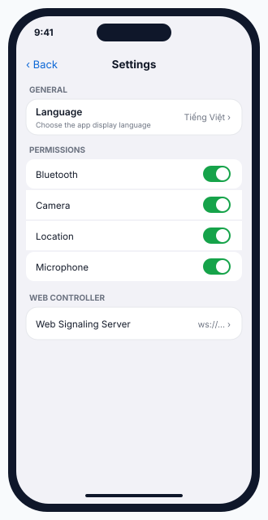</p>

* **General → Language**: app language.
* **Permissions**: Bluetooth, Camera, Location, Microphone. Every switch should be **on** for FriendBot.
* **Web Controller → Signaling Server**: only for the web controller in `controller/`.

*Example:* Voice Control cannot hear you → turn **Microphone** on here.

*Source (in `robot/ios/OpenBot/OpenBot/`):* `Controllers/Settings/SettingsFragment.swift`

## 5 Profile (Google sign-in)

<p align="center">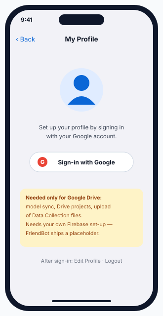</p>

Sign in with Google. You only need it for Google Drive: syncing models, Drive projects, and uploading Data Collection files.

**FriendBot ships a placeholder Firebase file**, so sign-in fails until you create your own Firebase project and replace the file. Everything else (driving, voice, AI, GPS) works without it.

*Source (in `robot/ios/OpenBot/OpenBot/`):* `Controllers/Profile/ProfileFragment.swift`, `GoogleService-Info.plist` (placeholder)

---

# Driving

## 6 Car setup

<p align="center">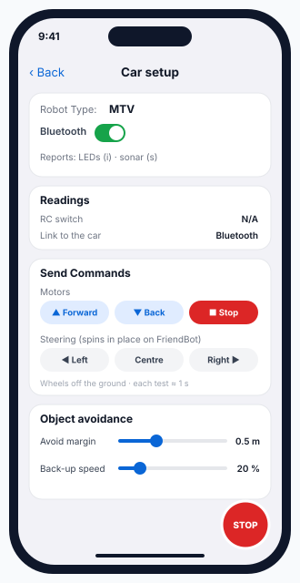</p>

Check the robot **before** you drive:

* **Robot Type**: `MTV`, link = Bluetooth.
* **Readings**: RC switch (N/A) and the link type.
* **Send Commands → Motors**: Forward / Back / Stop for about 1 s. **Steering**: Left / Centre / Right. FriendBot has no steering servo, so these spin it in place.
* **Object avoidance**: **Avoid margin** and **Back-up speed**.

*Example:* wheels off the ground → **Forward** → one wheel turns backwards → set `MOTOR_R_REVERSED 1` in the [firmware](FIRMWARE.md).

*Source (in `robot/ios/OpenBot/OpenBot/`):* `Controllers/RobotInfo/RobotInfoFrame.swift`

## 7 Drive

<p align="center">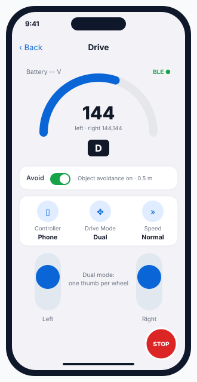</p>

Manual driving.

* **Gauge**: the value sent (0–255) and the gear **D / R / P**. **Avoid** switch: the app's avoidance gate. The firmware's sonar stop is always on as well.
* **Controller**: Phone (on screen) / Gamepad / Web.
* **Drive Mode**: **Dual** (one thumb per wheel, best for FriendBot) / Game / Joystick / Tilt (tilt the phone, 4° dead zone).
* **Speed**: Slow / Normal / Fast = 128 / 192 / 255 at full stick.

*Example:* Normal, both thumbs fully up → `c192,192`. A box 30 cm ahead → the firmware reduces it to about `c82,82` on its own.

*Source (in `robot/ios/OpenBot/OpenBot/`):* `Controllers/FreeRoam/FreeRoamController.swift`, `GaugeView.swift`

## 8 Controller Mapping

<p align="center">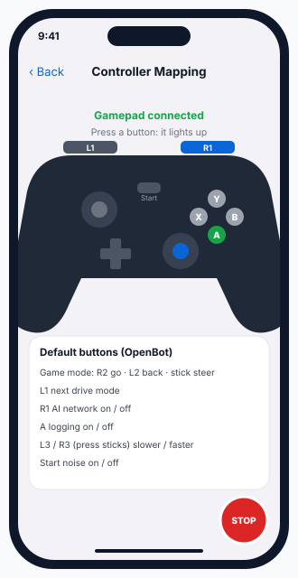</p>

Test a Bluetooth gamepad. Pair it in the **phone's** Bluetooth settings, open this screen and press every button: each one lights up. Then in **Drive** choose **Controller = Gamepad**.

| Button | Does |
|---|---|
| R2 / L2 + left stick | drive (Game mode) |
| L1 | next drive mode |
| R1 | AI network on / off |
| A | data logging on / off |
| press left / right stick | slower / faster |
| Start | noise on / off |

*Source (in `robot/ios/OpenBot/OpenBot/`):* `Controllers/GameView/GameViewController.swift`

## 9 GPS Mission

<p align="center">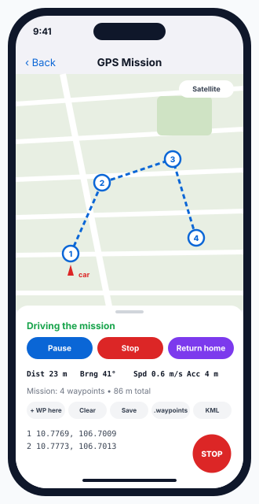</p>

Waypoint driving with the **phone's GPS**, like ArduPilot Mission Planner.

1. Go outside and wait until **Acc** is 15 m or better.
2. Tap the map → **Add as waypoint** (or **Add WP** = where you stand).
3. **Start** · **Pause** · **Stop** · **Return home** (back to the start point H).
4. **Files** menu: open / share **.waypoints** (Mission Planner), export **KML** (Google Earth).

Tap the map → **Go here now** drives to that one point (GUIDED).
**Rules:** reached within **4 m**. The robot holds if accuracy is worse than 15 m or there has been no fix for 3 s.

*Example:* 4 waypoints around a park, 86 m. HUD `Dist 23 m · Brng 41°`.

*Source (in `robot/ios/OpenBot/OpenBot/`):* `Controllers/GpsNav/GpsMissionController.swift`, `GpsNavCore.swift`

## 10 GPS Mission: tap menu

<p align="center">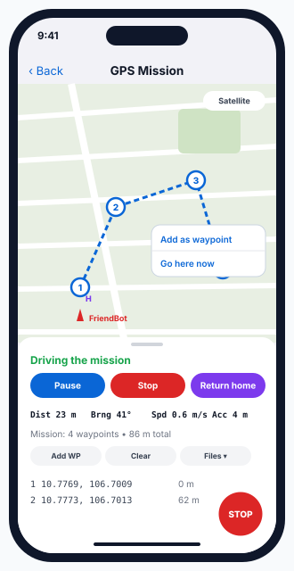</p>

Tapping the map opens **Add as waypoint / Go here now**. The bottom sheet shows the HUD and the waypoint list with coordinates and distances. More: [AI_AND_MISSION.md §1](AI_AND_MISSION.md#1--gps-mission).

*Source (in `robot/ios/OpenBot/OpenBot/`):* `Controllers/GpsNav/`

---

# Voice

## 11 Voice Control

<p align="center">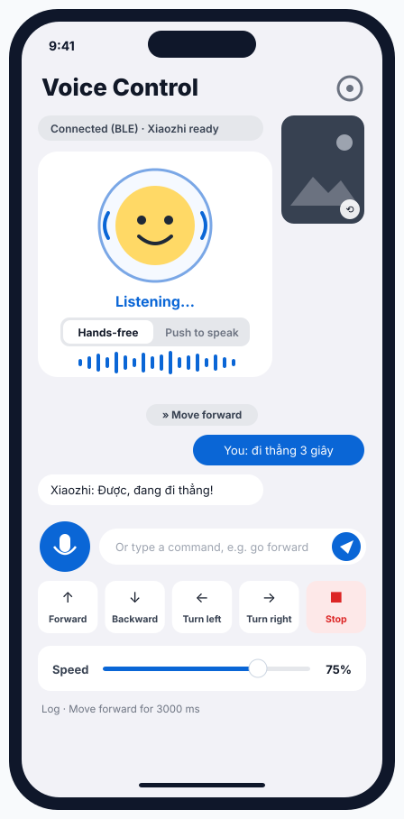</p>

Talk to FriendBot in **English, Tiếng Việt or 中文**. The Xiaozhi AI answers out loud and moves the robot.

<p align="center">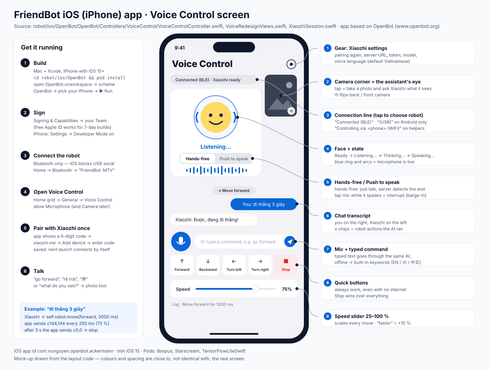</p>

| You do | What happens |
|---|---|
| Just speak (hands-free, default) | **Listening… → Thinking… → Speaking…**, reply in Xiaozhi's voice |
| **Push to speak** | tap the mic to start, tap again to send |
| Tap the mic while it talks | interrupts the reply (barge-in) |
| Type a command | same AI; offline it uses the keywords below |
| Quick buttons / Stop | always work, no internet needed |
| Speed slider | 25–100 %, default 75 %; "faster"/"slower" = ±15 % |
| Camera corner | tap = photo → "what do you see?"; ⟲ = front/back camera |
| Gear | Xiaozhi settings (see the next section) |

*Example:* **"rẽ trái"** → "Rẽ trái nhé!" + chip **» Turn left** → `c-144,144` over Bluetooth every 250 ms for 1.2 s, then `c0,0`. The robot spins left and its left LED blinks.

**Built-in keywords** (offline, and a safety net):

| English | Tiếng Việt | 中文 | Action |
|---|---|---|---|
| stop, halt | dừng, dừng lại, đứng lại | 停, 停止, 别动 | Stop (always wins) |
| back, reverse | lùi, lùi lại | 后退, 倒, 向后 | Backward |
| left, turn left | trái, rẽ trái | 左, 左转 | Spin left |
| right, turn right | phải, rẽ phải | 右, 右转 | Spin right |
| faster / slower | nhanh / chậm | 快 / 慢 | Speed ±15 % |
| forward, go | tiến, đi | 前进, 向前, 走 | Forward |

*Why "stop" is checked first:* "đừng đi" / "don't go" contains "go", but must not drive.

### Xiaozhi pairing and settings

| First launch: pairing code | Gear: Xiaozhi settings |
|:---:|:---:|
| 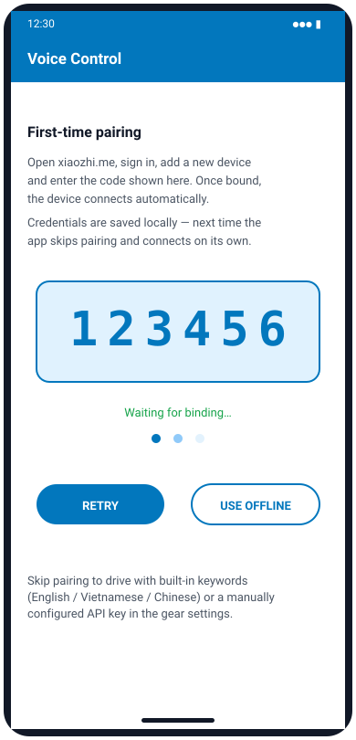 | 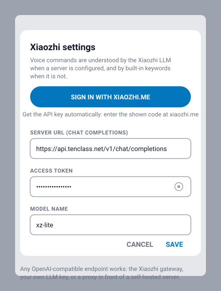 |

**Thêm thiết bị vào Xiaozhi Console** (get the code connected):
1. Truy cập **<https://xiaozhi.me/console/agents>**
2. Tạo Agent mới (hoặc chọn Agent hiện có)
3. Click **"Add Device"**
4. Nhập **mã 6 số** hiện trên màn hình Voice Control
5. ✅ Hoàn tất! The app shows "Bound! Connecting…" → "Xiaozhi ready". Next time it connects by itself.

The code works for **5 minutes**. **Retry** gives a new one. **Use offline mode** skips pairing (quick buttons + keywords only).
**Gear:** sign in again, choose the voice language (default Tiếng Việt), or set your own OpenAI-compatible server for typed commands.

Step by step with the website screens: [XIAOZHI_PAIRING.md](XIAOZHI_PAIRING.md).

*Source (in `robot/ios/OpenBot/OpenBot/`):* `Controllers/VoiceControl/VoiceControlController.swift`, `XiaozhiSession.swift`, `VoiceInterpreter.swift`

## 12 Remote Mic

<p align="center">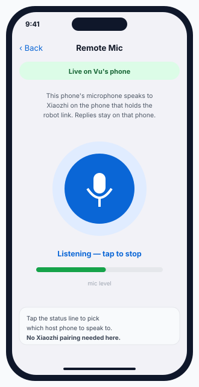</p>

A **second phone** becomes a wireless microphone for the phone that holds the robot link.

1. Host phone: open **Voice Control**. It starts sharing over Wi-Fi.
2. This phone (same Wi-Fi): **Remote Mic** → tap the mic.
3. The status shows **"Live on <host>"**. Speak: the host's Xiaozhi hears you, and replies play on the host.

No Xiaozhi pairing is needed on this phone. Tap the status line to choose another host.

*Source (in `robot/ios/OpenBot/OpenBot/`):* `Controllers/VoiceControl/RemoteMicController.swift`, `VoiceRelayServer.swift`

---

# AI

## 13 Data Collection

<p align="center">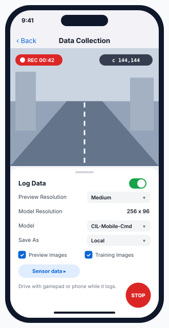</p>

Records camera images + your drive commands + sensors while you drive. This is the training data for your own Autopilot.

1. Choose **Preview / Model resolution**, **Model**, **Save As** (Local / Drive / Server), and the **Sensor data** to log.
2. Turn **Log Data** on (or press **A** on the gamepad). Drive for 5–15 min, then turn it off. Each session is saved as one zip file.

*Example:* 10 min at 10 fps ≈ 6,000 image + command pairs. *Why include some corrections:* the model copies you. If it never sees you steer back from the edge, it never learns to.

*Source (in `robot/ios/OpenBot/OpenBot/`):* `Controllers/DataCollection/DataCollectionController.swift`

## 14 Autopilot

<p align="center">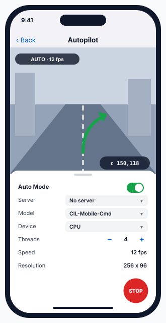</p>

A neural network turns each camera frame into wheel commands. The default model is CIL-Mobile-Cmd, with a 256×96 input.

Mount the phone with the camera facing forward → **Model**, **Device** (CPU / GPU / XNNPACK), **Threads** (1–9) → **Auto Mode** on. **STOP** or Auto off takes over again.

The built-in model was trained on OpenBot robots, not your rooms. Train your own (Data Collection → OpenBot `policy/` → Model Management).

*Example:* the corridor bends right → the network outputs `c150,118`.

*Source (in `robot/ios/OpenBot/OpenBot/`):* `Controllers/Autopilot/`

## 15 Object Tracking

<p align="center">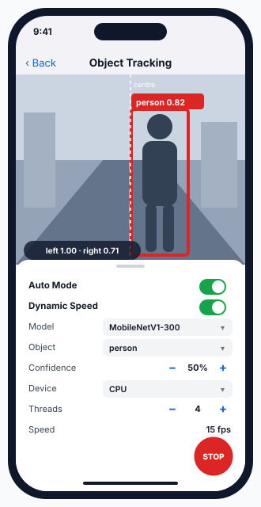</p>

Finds a class of object (person, dog, ball… from the 80 COCO classes) and drives towards it.

**Object**, **Model**, **Confidence** − / + (5 % steps, default 50 %), **Device** (CPU / GPU / XNNPACK), **Threads** → **Auto Mode** on, and **Dynamic Speed** on so it stops before reaching you.

Steering: object right of centre → left 1.0, right 1 − |x|. Dynamic Speed slows the robot as the box grows and stops it above 75 % of the frame.

*Example:* "person 0.82" a little right of centre → `c192,136` → the robot turns right towards you.

*Source (in `robot/ios/OpenBot/OpenBot/`):* `Controllers/ObjectTracking/`

## 16 Point Goal Navigation

<p align="center">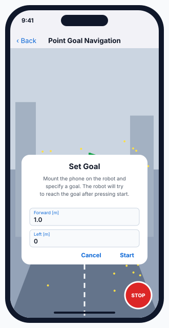</p>

Type a goal (**Forward [m]**, **Left [m]**) → **Start**. The robot drives there using **ARKit** to know where it is, plus the PilotNet-Goal network (160×90 input).

Use a well-lit room with texture on the floor and walls. It reports "Goal reached.", or "Tracking lost." if AR loses track. Works on any iPhone with ARKit world tracking (iPhone 6s or newer).

*Example:* Forward `2.0`, Left `-0.5` = 2 m ahead and 0.5 m to the right. *Why AR:* FriendBot has no wheel encoders.

*Source (in `robot/ios/OpenBot/OpenBot/`):* `Controllers/PointGoalNavigation/PointGoalFragment.swift`

## 17 Model Management

<p align="center">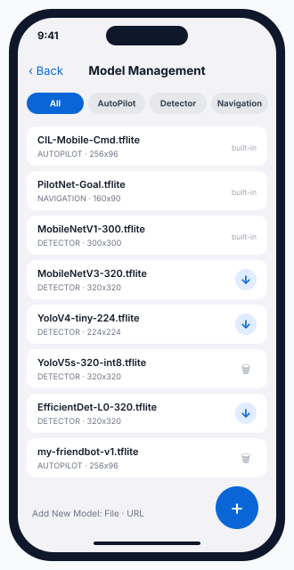</p>

All neural networks: 3 are built in, and 11 detectors can be downloaded with **↓** (MobileNetV3, YOLOv4/v5, EfficientDet).

* Filter chips: All / AutoPilot / Detector / Navigation.
* **Add New Model** → **File** or **URL** → fill in **Model Details** (next screen).

*Source (in `robot/ios/OpenBot/OpenBot/`):* `Controllers/ModelManagement/`

## 18 Model Details (add your own model)

<p align="center">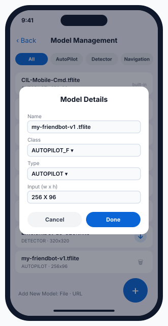</p>

**Name**, **Class**, **Type** (AUTOPILOT / DETECTOR / NAVIGATION) and **Input w × h**. The input must match how the model was trained.

*Example:* `my-friendbot-v1.tflite`, AUTOPILOT, 256 × 96 → it appears under Autopilot → Model.

*Source (in `robot/ios/OpenBot/OpenBot/`):* `Controllers/ModelManagement/`

---

## Several phones, one robot

* The phone with the robot link **shares it over Wi-Fi** while its Voice Control page is open.
* Another phone on the same Wi-Fi: **Voice Control** shows "Controlling via <phone> (WiFi)" and drives through the host, or **Remote Mic** works as a wireless microphone.
* A **Stop** from any phone stops the robot for everyone.

## Safety, layer by layer

| Layer | What it does | Where |
|---|---|---|
| STOP button | overrides every screen until RESUME | app, every screen |
| Move timeout | each voice move ends by itself (default 1.2 s, max 8 s) | Voice Control |
| Unknown words → stop | never guesses | Voice Control |
| Leave a screen → stop | motors stop when you go back | AI and voice screens |
| Sonar stop | slow from 50 cm, stop at 15 cm, back up below 5 cm | [firmware](FIRMWARE.md) |
| Link lost → stop | Bluetooth disconnect or heartbeat timeout | firmware |

## Troubleshooting

| Problem | Fix |
|---|---|
| `pod install` fails | `pod repo update`, try again; Apple-silicon Mac: install CocoaPods with Homebrew |
| "No such module …" | you opened the `.xcodeproj`: open `OpenBot.xcworkspace` |
| Signing error | pick your Team, change the bundle id |
| `FriendBot: MTV` not listed | robot on? Not connected to another phone? Toggle iPhone Bluetooth |
| App won't open after a week | free-account build expired: Run again from Xcode |
| Pairing code not accepted | enter it within 5 min; **Retry** for a new one |
| Helper phone can't find the robot | allow **Local Network** in iPhone Settings → FriendBot |
| Google sign-in fails | expected with the placeholder Firebase file (see Profile) |

## Questions to go deeper

1. Why does every screen share **one** STOP button, and why does the firmware still need its own sonar stop?
2. Voice Control re-sends `c<l>,<r>` every 250 ms, but Car setup sends a command once. Which is safer if the link drops, and why?
3. Which screens need the **internet** (Xiaozhi, model downloads, maps) and which work fully offline?
4. Autopilot and Object Tracking both drive from the camera. Which would you trust in a new room, and how would you test it safely?
5. If you added wheel encoders to FriendBot, which screens would show new information, and which features would become more accurate?
