# FriendBot app · guide to every screen (Android and iOS)

This is the one-stop guide to **all screens** of the FriendBot robot app. Every section shows the **Android** and **iOS** screens side by side, then what the screen is, how to use it, an example and, where useful, *why* it works that way. Links at the end of a section go to the deeper guides.

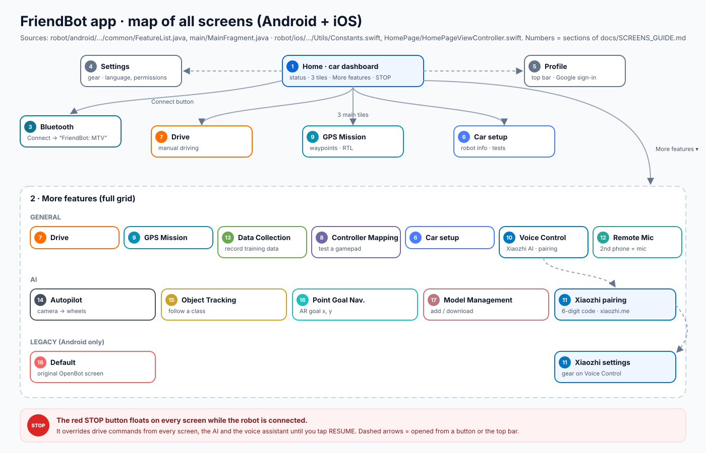

*How the pictures were made:* each screen is drawn from the app's layout code (`robot/android/app/src/main/res/layout/…`, `robot/ios/OpenBot/OpenBot/Controllers/…`), so the controls and labels match the apps. Numbers like `144` or `23 m` are examples. The app is based on [OpenBot](https://www.openbot.org). The SVG files are in [`docs/images/screens/android`](images/screens/android) and [`docs/images/screens/ios`](images/screens/ios).

## The STOP button (on every screen)

A red **STOP** floats on every screen while the robot is connected. It overrides **every** drive command (your thumbs, a GPS mission, the AI, the voice assistant) until you tap **RESUME**. The firmware's sonar stop works on its own as well, even if the phone freezes.

## Contents

1. [Home (car dashboard)](#1-home-car-dashboard)
2. [More features](#2-more-features)
3. [Bluetooth](#3-bluetooth)
4. [Settings](#4-settings)
5. [Profile (Google sign-in)](#5-profile-google-sign-in)
6. [Car setup](#6-car-setup)
7. [Drive (manual)](#7-drive-manual)
8. [Controller Mapping](#8-controller-mapping)
9. [GPS Mission](#9-gps-mission)
10. [Voice Control](#10-voice-control)
11. [Xiaozhi pairing and settings](#11-xiaozhi-pairing-and-settings)
12. [Remote Mic](#12-remote-mic)
13. [Data Collection](#13-data-collection)
14. [Autopilot](#14-autopilot)
15. [Object Tracking](#15-object-tracking)
16. [Point Goal Navigation](#16-point-goal-navigation)
17. [Model Management](#17-model-management)
18. [Default (Legacy, Android only)](#18-default-legacy-android-only)

---

# Getting started

## 1 Home (car dashboard)

| Android | iOS |
|:---:|:---:|
| 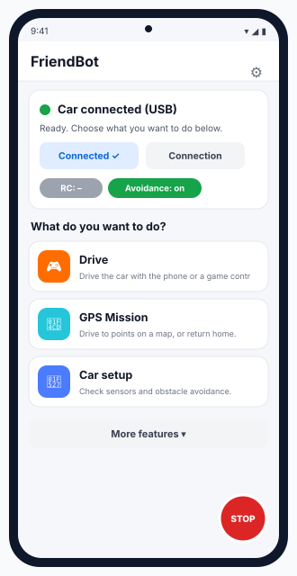 | 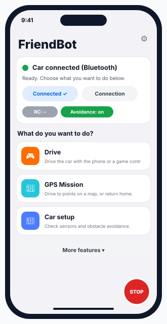 |
**What it is.** The first screen. It answers one question: *is the robot ready?*

**What you see**
* **Status card**: green dot + "Car connected (USB)" (Android) or "(Bluetooth)". If not connected, it shows "Car not connected" with a hint.
* **Connect / Connection** buttons, plus **RC** and **Avoidance** chips. FriendBot has no RC receiver, so the RC chip shows "RC: –".
* Three task tiles: **Drive**, **GPS Mission**, **Car setup**.
* **More features ▾** (section 2), the **gear** (Settings, section 4), the **profile** icon (section 5), and the red **STOP**.

**Example.** You switch the robot on and the card says "Car not connected". Tap **Connect**, pick `FriendBot: MTV`, and the dot turns green.

**Why a dashboard:** most of the time you only need three tasks, and the status card tells you at once why the robot doesn't move.

*Source:* `main/MainFragment.java`, `res/layout/fragment_main.xml` · iOS `HomePage/CarDashboard.swift`.

## 2 More features

| Android | iOS |
|:---:|:---:|
| 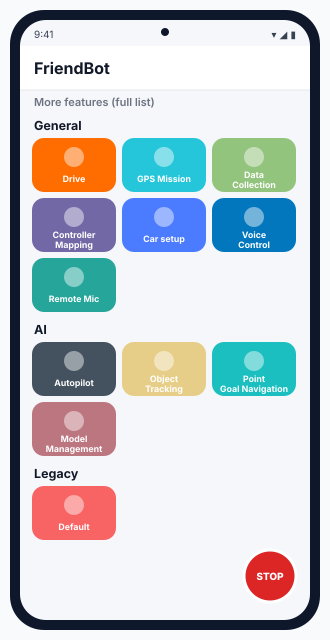 | 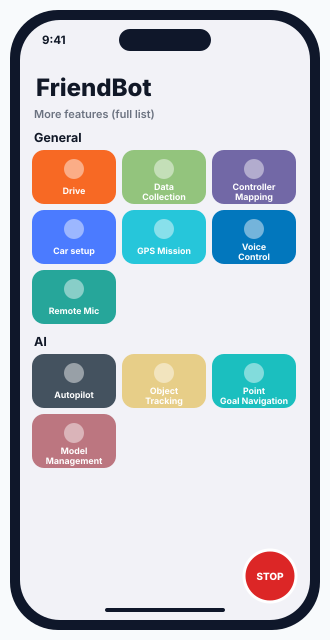 |
**What it is.** The full feature grid.
* **General:** Drive, GPS Mission, Data Collection, Controller Mapping, Car setup, Voice Control, Remote Mic.
* **AI:** Autopilot, Object Tracking, Point Goal Navigation, Model Management.
* **Legacy** (Android only): Default.

**Example.** Want "follow me"? **More features → AI → Object Tracking**.

*Source:* `common/FeatureList.java` · iOS `Utils/Constants.swift` (the iOS order is slightly different and has no Legacy group).

## 3 Bluetooth

| Android | iOS |
|:---:|:---:|
| 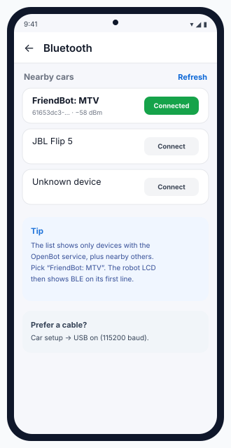 | 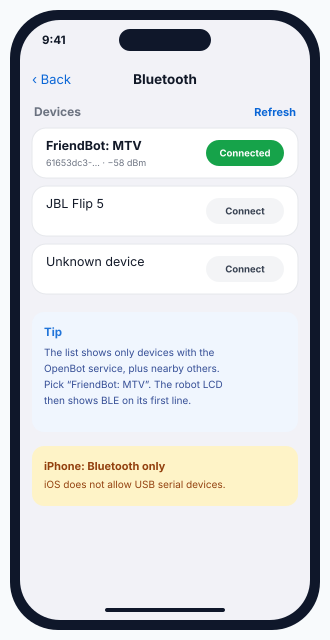 |
**What it is.** Finds the robot over Bluetooth LE.

**How**
1. Switch the robot on. Its LCD shows `FriendBot MTV`.
2. Tap **Connect** next to **`FriendBot: MTV`**.
3. The LCD's first line ends with ` BLE`, and Home shows the green dot.

**Android vs iOS.** Android can also use a **USB cable** (Car setup → USB, 115200 baud). The iPhone can only use Bluetooth, because iOS doesn't let apps talk to USB serial devices.

**Why "MTV" in the name:** it is the robot type the firmware reports (`ROBOT_TYPE`). The apps use it to pick the right features.

*Source:* `res/layout/fragment_bluetooth.xml` · iOS `Bluetooth/BluetoothTable.swift` · firmware `ble_begin()`.

## 4 Settings

| Android | iOS |
|:---:|:---:|
| 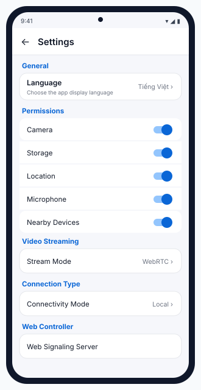 | 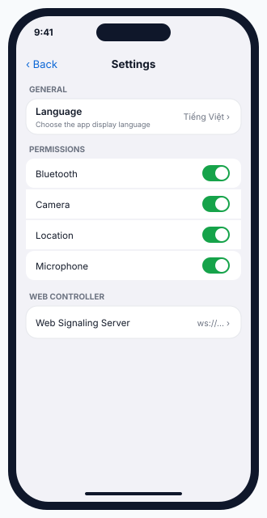 |
**What it is.** App-wide options.

| Android | iOS |
|---|---|
| Language · Permissions (Camera, Storage, Location, Microphone, Nearby Devices) · Video Streaming · Connection Type · Web Controller | Language · Permissions (Bluetooth, Camera, Location, Microphone) · Web Controller |

**Example.** Voice Control can't hear you → check that **Microphone** is on here.

*Source:* `res/xml/root_preferences.xml` · iOS `Settings/SettingsFragment.swift`.

## 5 Profile (Google sign-in)

| Android | iOS |
|:---:|:---:|
| 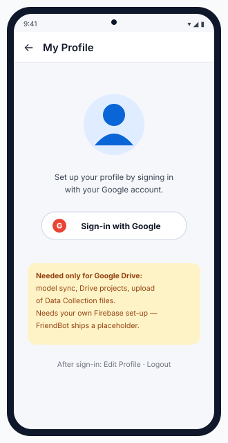 | 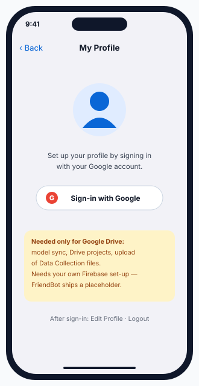 |
**What it is.** Google sign-in, needed only for Google Drive features: syncing models, Drive projects, and uploading Data Collection files.

**Important.** FriendBot ships a *placeholder* Firebase file, so sign-in won't work until you create your own Firebase project and replace `google-services.json` (Android) and `GoogleService-Info.plist` (iOS). Everything else works without signing in.

*Source:* `profile/`, `res/layout/fragment_profile.xml` · iOS `Profile/ProfileFragment.swift`.

---

# Driving

## 6 Car setup

| Android | iOS |
|:---:|:---:|
| 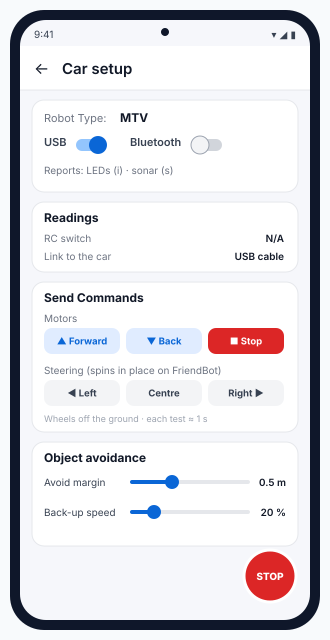 | 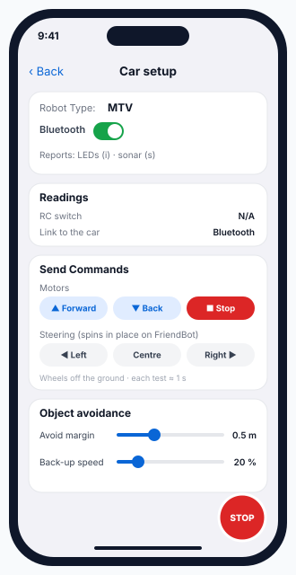 |
**What it is.** Checks the robot before you drive.

**What you see**
* **Robot Type**: `MTV`. **USB / Bluetooth** toggles (iOS: Bluetooth only).
* **Readings**: RC switch (N/A on FriendBot) and the link type.
* **Send Commands**: **Motors** Forward / Back / Stop (about 1 s each) and **Steering** Left / Centre / Right. FriendBot has no steering servo, so these spin it in place.
* **Object avoidance**: **Avoid margin** and **Back-up speed** sliders.

**Example.** Wheels off the ground, tap **Forward**. If one wheel turns backwards, set `MOTOR_L_REVERSED` or `MOTOR_R_REVERSED` in the firmware ([Firmware guide](FIRMWARE.md)).

**Why test here first:** it is the safest place to find wiring mistakes before you trust voice, AI or missions.

*Source:* `res/layout/fragment_robot_info.xml` · iOS `RobotInfo/RobotInfoFrame.swift`.

## 7 Drive (manual)

| Android | iOS |
|:---:|:---:|
| 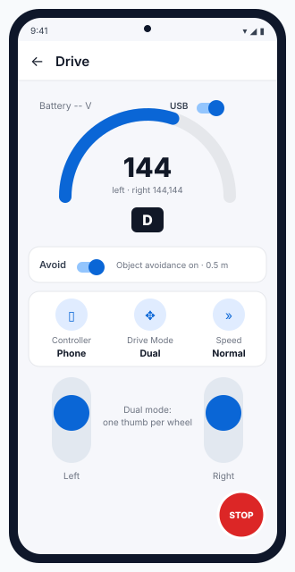 | 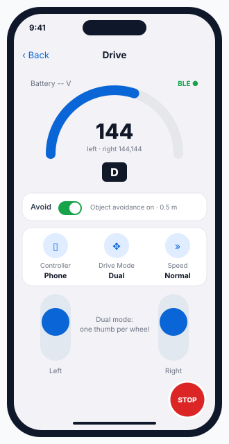 |
**What it is.** Driving by hand.

**Controls**
* **Gauge** shows the value sent to the robot (0–255) and the gear **D / R / P**. The **Avoid** switch turns the app's avoidance on or off. The firmware's own sonar stop is always on as well.
* **Controller**: Phone (on screen), Gamepad, or Web.
* **Drive Mode**: **Dual** (one thumb per wheel, the natural choice for FriendBot), Game, Joystick, or Tilt (4° dead zone).
* **Speed**: Slow / Normal / Fast, which sends 128 / 192 / 255 at full stick.

**Example.** Normal speed, both thumbs fully up → `c192,192`. If a box is 30 cm ahead, the firmware reduces this to about `c82,82` by itself.

*Source:* `res/layout/fragment_free_roam.xml`, `utils/Enums.java` · iOS `FreeRoam/`.

## 8 Controller Mapping

| Android | iOS |
|:---:|:---:|
| 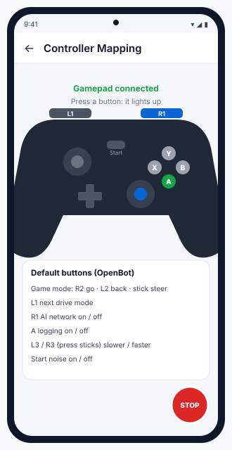 | 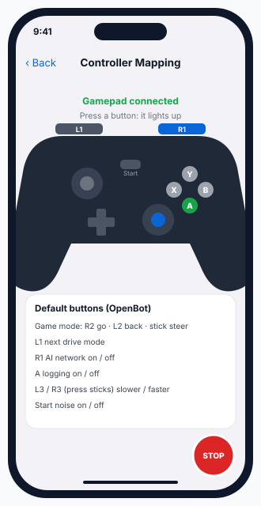 |
**What it is.** A test screen for a Bluetooth gamepad: every button you press lights up.

**How.** Pair the gamepad in the **phone's** Bluetooth settings, open this screen, and press each button. Then in Drive, choose **Controller = Gamepad**.

**Buttons (from the code):** L1 = next drive mode · R1 = AI network on/off · A = logging on/off · press left/right stick = slower/faster · Start = noise · Game mode: R2 forward, L2 back, stick to steer.

*Source:* `controller/ControllerMappingFragment.java`, `common/ControlsFragment.processKeyEvent` · iOS `GameView/GameViewController.swift`.

Full page: [controller-mapping.svg](images/controller-mapping.svg).

## 9 GPS Mission

| Android | iOS |
|:---:|:---:|
| 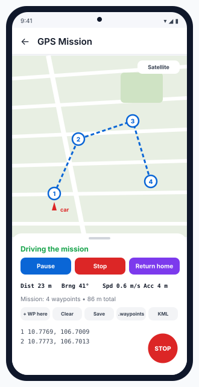 | 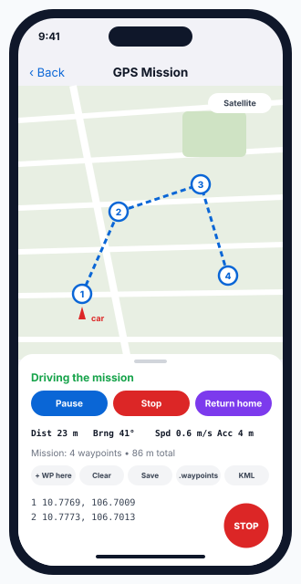 |
| 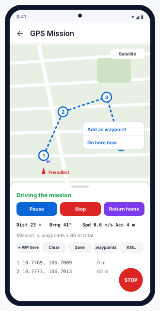 | 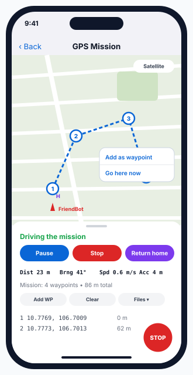 |
**What it is.** Waypoint driving with the **phone's GPS**. There are three modes: **MISSION** (all waypoints in order), **GUIDED** (tap the map → *Go here now*), and **RTL** (*Return home*).

**How**
1. Go outside and wait until **Acc** is 15 m or better.
2. Tap the map → **Add as waypoint**.
3. **Start**. You can **Pause** or **Stop** at any time; **Return home** goes back to the start point.
4. Save it, or share it as a `.waypoints` file (Mission Planner) or a **KML** file.

**Rules:** a waypoint counts as reached within **4 m**. The robot holds if accuracy is worse than **15 m** or there has been no fix for **3 s**.

**Example.** 4 waypoints around a park, 86 m in total. The HUD shows `Dist 23 m · Brng 41°`, the distance and compass bearing to the next waypoint.

*Source:* `gpsNav/` · iOS `GpsNav/GpsMissionController.swift`, `GpsNavCore.swift`.

More detail: [AI_AND_MISSION.md §1](AI_AND_MISSION.md#1--gps-mission) · [gps-mission.svg](images/gps-mission.svg).

---

# Voice

## 10 Voice Control

| Android | iOS |
|:---:|:---:|
| 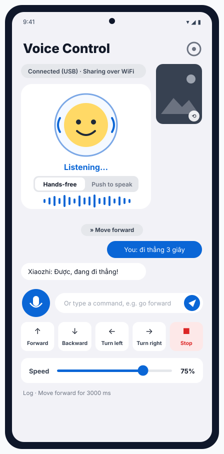 | 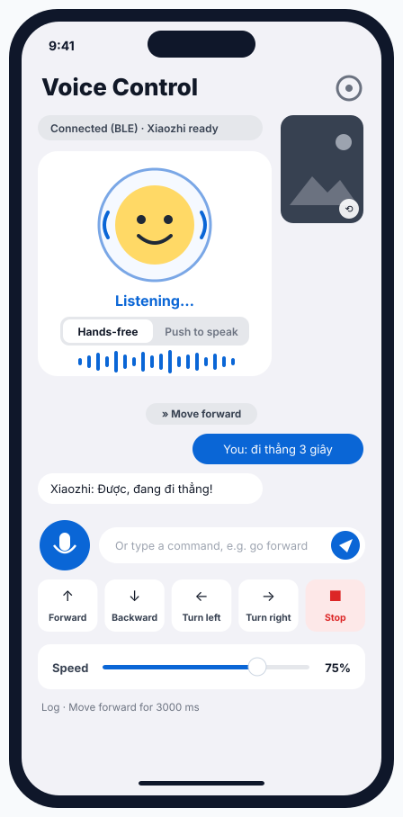 |
**What it is.** Talk to FriendBot in English, Tiếng Việt or 中文. The Xiaozhi AI answers out loud and moves the robot.

**What you see.** The face with its state (Ready → Listening… → Thinking… → Speaking…), the Hands-free / Push-to-speak switch, the chat transcript with `»` action chips, a text box, quick buttons, the speed slider, and the camera corner (tap it to take a photo and ask what the robot sees).

**Example.** You say "đi thẳng 3 giây" → chip **» Move forward** → the app sends `c144,144` every 250 ms for 3 s, then `c0,0`.

*Source:* `voice/VoiceControlFragment.java`, `res/layout/fragment_voice_control.xml` · iOS `VoiceControl/VoiceControlController.swift`.

Annotated: [android-app.svg](images/android-app.svg) · [ios-app.svg](images/ios-app.svg) · guides: [Android](ANDROID_APP.md) · [iOS](IOS_APP.md).

## 11 Xiaozhi pairing and settings

| Pairing (first launch) | Settings (gear) |
|:---:|:---:|
| 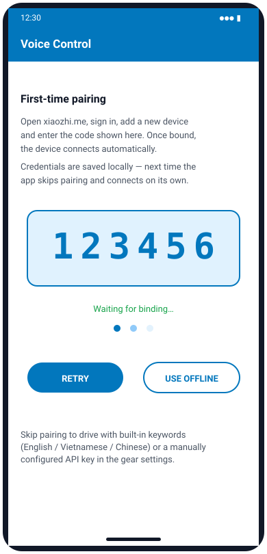 | 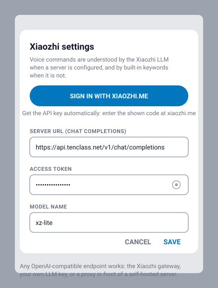 |

**Get the code, quick version (Tiếng Việt)**
1. Truy cập **<https://xiaozhi.me/console/agents>**
2. Tạo Agent mới (hoặc chọn Agent hiện có)
3. Click **"Add Device"**
4. Nhập **mã 6 số** từ màn hình Voice Control của ứng dụng FriendBot
5. ✅ Hoàn tất! The app shows "Bound! Connecting…" and then "Xiaozhi ready".

The code works for **5 minutes**. Tap **Retry** for a new one.

**Settings (gear):** sign in again, change the voice language (default Tiếng Việt), or set a custom OpenAI-compatible server for typed commands.

Step-by-step with the website screens: [XIAOZHI_PAIRING.md](XIAOZHI_PAIRING.md) · [xiaozhi-connect.svg](images/xiaozhi-connect.svg).

## 12 Remote Mic

| Android | iOS |
|:---:|:---:|
| 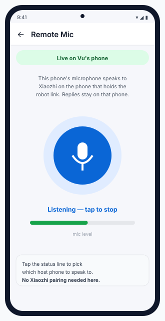 | 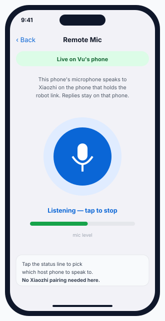 |
**What it is.** Turns a **second phone** into a wireless microphone for the phone that holds the robot link.

**How**
1. On the host phone, open **Voice Control**.
2. On the second phone (same Wi-Fi), open **Remote Mic** and tap the mic.
3. The status shows "Live on <host>". Speak, and the replies play on the host.

The second phone doesn't need Xiaozhi pairing. iOS asks for *Local Network* permission the first time.

*Source:* `voice/RemoteMicFragment.java`, `voice/relay/` · iOS `VoiceControl/RemoteMicController.swift`.

---

# AI

## 13 Data Collection

| Android | iOS |
|:---:|:---:|
| 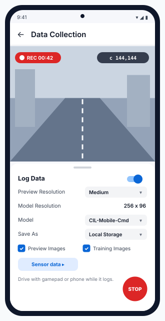 | 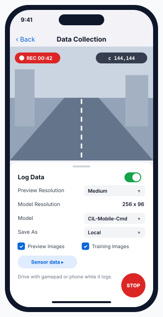 |
**What it is.** Records camera images, your drive commands and phone sensors while you drive. This is the training data for your own Autopilot.

**How**
1. Connect the robot and a gamepad (or drive with the phone).
2. Choose **Preview Resolution**, **Model**, **Save As** (Local Storage / Google Drive / Local Server) and the **Sensor data** to log.
3. Turn **Log Data** on (or press **A** on the gamepad), drive for 5–15 minutes, then turn it off. Each session is saved as one zip file.

**Example.** 10 minutes at 10 fps ≈ 6,000 image + command pairs, enough for a first corridor model.

**Why drive smoothly and include some "recoveries":** the model copies you. If it never sees you correct a drift, it never learns how.

*Source:* `logging/LoggerFragment.java`, `res/layout/fragment_logger.xml` · iOS `DataCollection/DataCollectionController.swift`.

Full page: [data-collection.svg](images/data-collection.svg).

## 14 Autopilot

| Android | iOS |
|:---:|:---:|
| 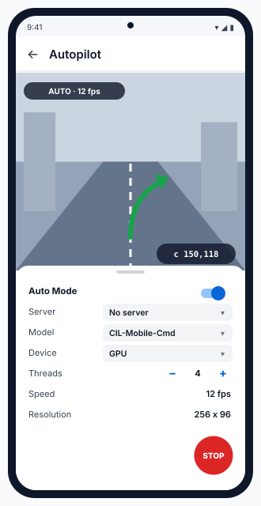 | 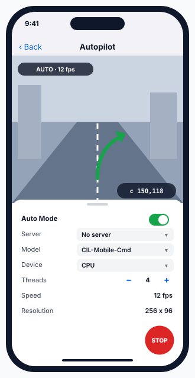 |
**What it is.** A neural network turns each camera frame into wheel commands. The default model is CIL-Mobile-Cmd, with a 256 × 96 input.

**How.** Mount the phone with the camera facing forward → choose **Model**, **Device** and **Threads** → **Auto Mode** on → STOP or Auto off to take over.

**Important:** the built-in model was trained on OpenBot's robots, not on your rooms. Train your own with Data Collection (section 13) and Model Management (section 17).

**Example.** At 12 fps, the network sees the corridor bending right and outputs `c150,118`.

More: [AI_AND_MISSION.md §2](AI_AND_MISSION.md#2--autopilot) · [autopilot.svg](images/autopilot.svg).

## 15 Object Tracking

| Android | iOS |
|:---:|:---:|
| 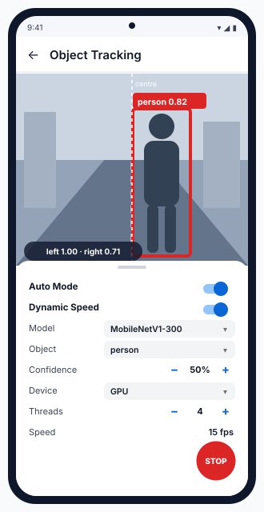 | 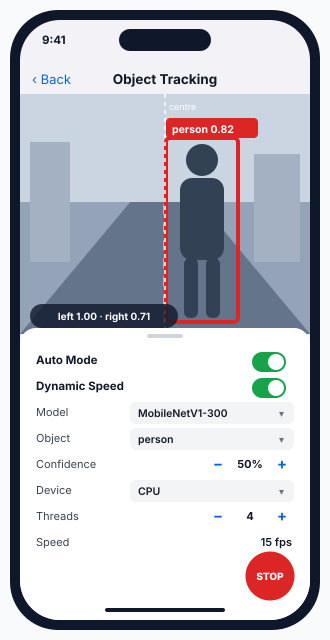 |
**What it is.** Finds a class of object (person, dog, ball…) and drives towards it.

**How.** Choose **Object** and **Model**, set **Confidence** with − / + (default 50 %), then turn on **Auto Mode** and **Dynamic Speed**.

**Steering rule:** an object right of centre gives left 1.0, right 1 − |x|. Dynamic Speed slows the robot as the box grows and stops it when the box covers more than 75 % of the frame.

**Example.** "person 0.82" slightly to the right → about `c192,136` → the robot turns right towards you.

More: [AI_AND_MISSION.md §3](AI_AND_MISSION.md#3--object-tracking-follow-me) · [object-tracking.svg](images/object-tracking.svg).

## 16 Point Goal Navigation

| Android | iOS |
|:---:|:---:|
| 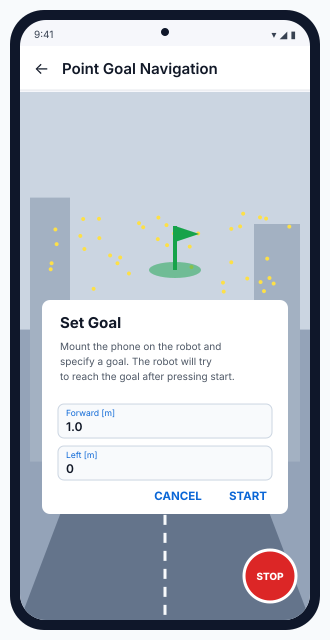 | 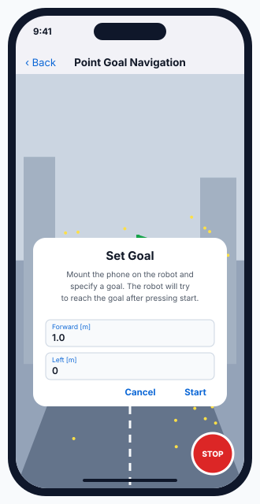 |
**What it is.** You type a goal, for example **Forward 1.0 m, Left 0 m**, and the robot drives there using AR (ARCore on Android, ARKit on iOS) plus the PilotNet-Goal network.

**How.** Use a well-lit room with texture on the floor and walls → **Set Goal** → **Start** → wait for "Goal reached." ("Tracking lost." means AR lost its position.)

**Example.** Forward `2.0`, Left `-0.5` = 2 m ahead and 0.5 m to the right.

**Why AR:** FriendBot has no wheel encoders, so the phone measures how far it has moved.

More: [AI_AND_MISSION.md §4](AI_AND_MISSION.md#4--point-goal-navigation) · [point-goal-navigation.svg](images/point-goal-navigation.svg).

## 17 Model Management

| Android | iOS |
|:---:|:---:|
| 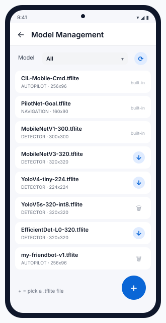 | 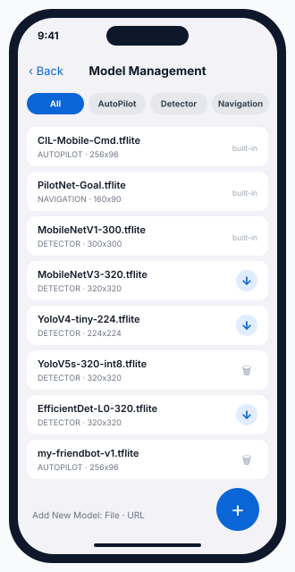 |
| 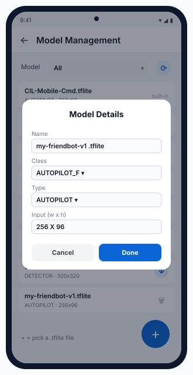 | 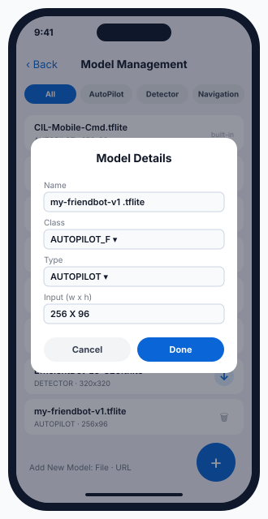 |
**What it is.** Lists the neural networks (3 built in, 11 downloadable detectors) and adds your own `.tflite` files.

**How**
* **Filter:** All / AUTOPILOT / NAVIGATION / DETECTOR. Tap **↓** to download a model.
* **Add your own:** Android **+** → pick a file. iOS **Add New Model** → File or URL.
* Fill in **Model Details** (second picture): Name, Class, Type, and Input w × h. The input size must match how the model was trained.

**Example.** `my-friendbot-v1.tflite` as AUTOPILOT, 256 × 96 → it appears in Autopilot → Model.

More: [AI_AND_MISSION.md §5](AI_AND_MISSION.md#5--model-management) · [model-management.svg](images/model-management.svg).

---

# Legacy

## 18 Default (Legacy, Android only)

| Android | iOS |
|:---:|:---:|
| 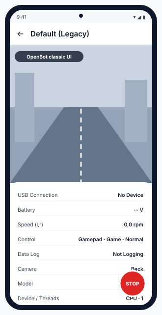 | *Not in the iOS app* |
**What it is.** The original OpenBot all-in-one screen: camera, USB, battery, wheel speed, control modes, logging, model and threads in one bottom sheet.

**When to use it:** only to compare with old OpenBot tutorials. For FriendBot, use Drive, Data Collection and Autopilot instead. Battery and wheel speed stay empty because the FriendBot firmware has no voltage divider or wheel encoders.

*Source:* `original/DefaultActivity.java`, `res/layout/layout_bottom_sheet.xml`.

---

## Questions to go deeper

1. Why does every screen share **one** STOP button instead of each having its own?
2. Which screens send drive commands *continuously* (every frame or every 250 ms) and which only once? Why does that matter if the Bluetooth link drops?
3. Drive, Voice Control and Object Tracking can all move the robot. If two of them were open on two phones at once, what should win, and how does the app decide today?
4. What would you need to change in Car setup and Drive so that the "Steering" controls make sense for a two-wheel robot instead of a car?
5. Which screen would you open first after flashing new firmware, and which numbers on it tell you the firmware is right?
