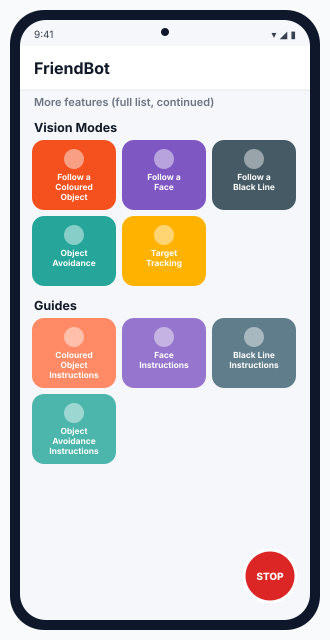
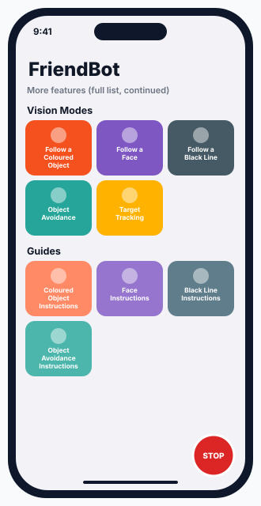
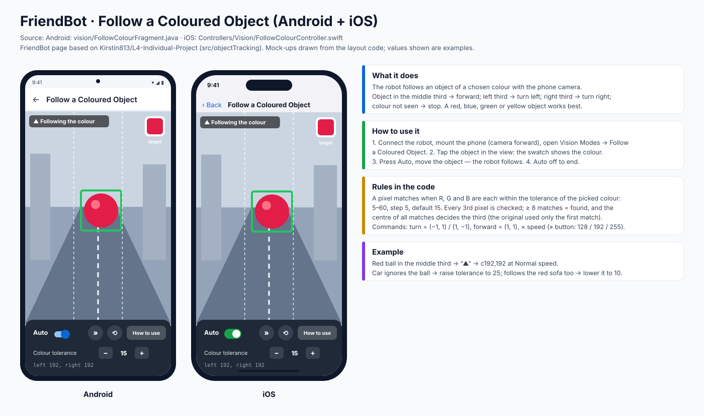
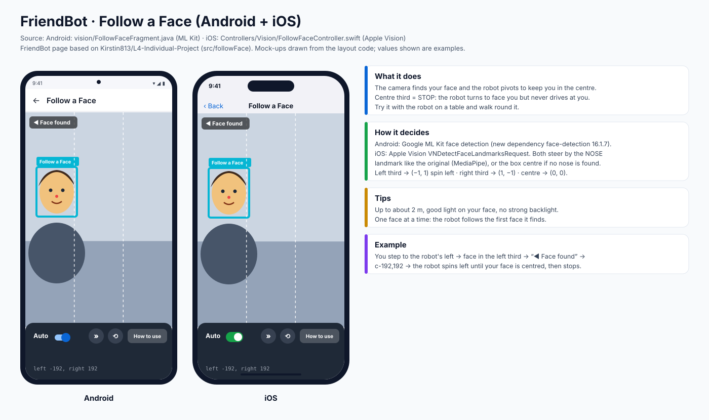
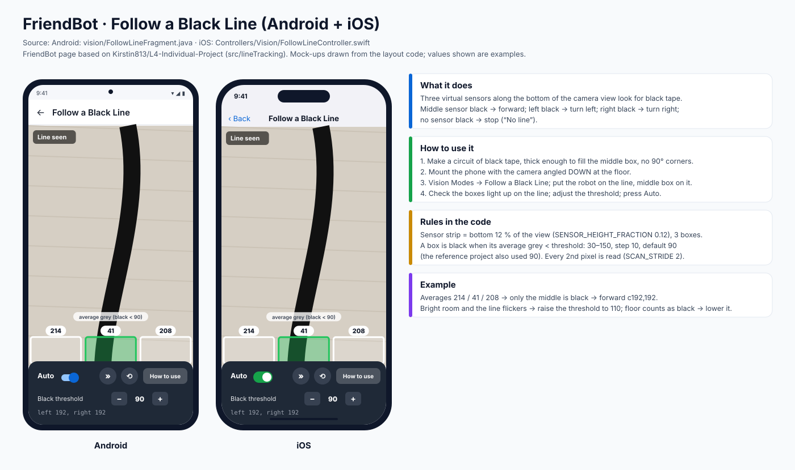
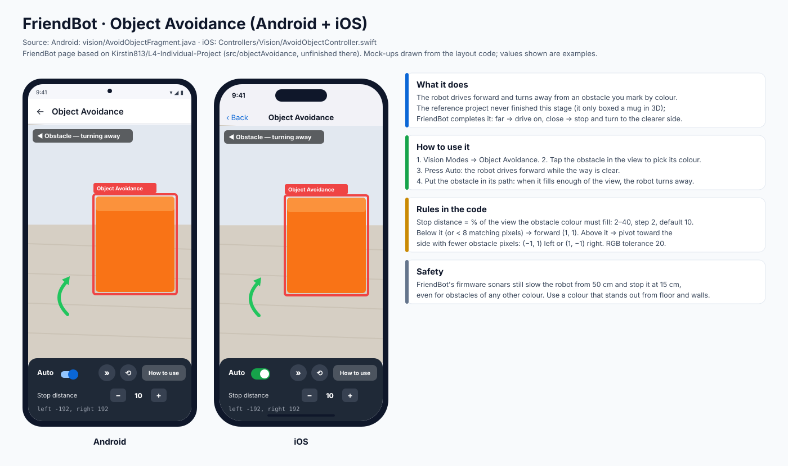
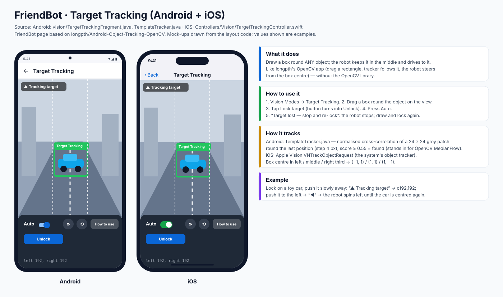
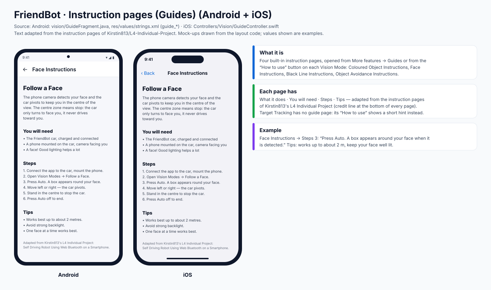

# 8 · Vision Modes: Coloured Object, Face, Black Line, Object Avoidance, Target Tracking

> All screens in one place: **[SCREENS_GUIDE.md](SCREENS_GUIDE.md)** · per app: [Android](ANDROID_APP.md) · [iOS](IOS_APP.md)

Five camera behaviours plus four instruction pages, added to both apps in the **Vision Modes** and **Guides** groups of *More features*. They are based on:
* **[Kirstin813/L4-Individual-Project](https://github.com/Kirstin813/L4-Individual-Project)**: "Self Driving Robot Using Web Bluetooth on a Smartphone" (pages: Follow a Coloured Object, Follow a Face, Follow a Black Line, Object Avoidance, and their instruction pages).
* **[longpth/Android-Object-Tracking-OpenCV](https://github.com/longpth/Android-Object-Tracking-OpenCV)**: draw a box round an object and track it (Target Tracking).

*Sources in this repo:* Android `robot/android/app/src/main/java/org/openbot/app/robot/vision/`, iOS `robot/ios/OpenBot/OpenBot/Controllers/Vision/`.

> **Android:** included in the APK in [`apk/`](../apk/) (built 6 Nov 2026). **iOS:** build with Xcode ([iOS guide](IOS_APP.md)).

 &nbsp; 

## What all five modes share

| Part of the screen | What it does |
|---|---|
| Camera view + dashed lines | the view is split into **left / middle / right thirds** (except Black Line and Object Avoidance) |
| Status line (top left) | `▲` forward · `◀` left · `▶` right · `■` stop, plus a short message |
| **Auto** switch | starts / stops driving (gamepad **R1** does the same) |
| **»** | speed: Slow / Normal / Fast = 128 / 192 / 255 at full command |
| **⟲** | front / back camera |
| **How to use** | opens the mode's instruction page |
| Setting row | the mode's own − / + value |
| `left …, right …` | what is being sent to the wheels |

All modes send only **spin-left (−1, 1)**, **forward (1, 1)**, **spin-right (1, −1)** or **stop (0, 0)**, multiplied by the speed. A command is sent only when it changes. Leaving the page or turning Auto off stops the robot. *Why so simple:* the same thirds rule as the reference project makes each behaviour easy to understand and to test.

---

## 1 · Follow a Coloured Object

**What it does.** The robot follows an object of a colour you pick.

**Steps (from the in-app instructions)**
1. Connect the app to the car and mount the phone on the car.
2. Open **Vision Modes → Follow a Coloured Object**.
3. **Tap the object** in the camera view to sample its colour. The swatch shows what was picked.
4. Press **Auto**. The car turns toward the object and drives forward while it sits in the middle third.
5. Walk or roll the object around and the car follows it.
6. Turn **Auto** off (or take the object out of view and the car stops) to end.

**Rules in the code:** a pixel matches when its R, G and B are each within the **tolerance** of the picked colour (5–60, step 5, default 15). Every 3rd pixel is checked; 8 or more matches means found. The **centre of all matches** decides the third (the original used only the first matching pixel). Colour lost → stop.

**Example.** Red ball in the middle third → `c192,192` at Normal speed. The car ignores the ball → raise the tolerance to 25. It follows the red sofa too → lower it to 10.

**Tips:** a solid, bright colour (red, blue, green, yellow) that contrasts with the background; even lighting.

---

## 2 · Follow a Face

**What it does.** The car pivots to keep your face in the centre. **The centre zone means stop:** the car only turns to face you and never drives toward you. Try putting it on a table and walking around it.

**How it detects a face**
| Android | iOS |
|---|---|
| Google **ML Kit** face detection (`com.google.mlkit:face-detection:16.1.7`, new dependency) | Apple **Vision** `VNDetectFaceLandmarksRequest` (built in) |

Both steer by the **nose** landmark, like the original's MediaPipe version, and use the face box centre if no nose is found.

**Steps:** Vision Modes → Follow a Face → **Auto** → a box appears round your face → move left or right and the car pivots → stand in the centre to stop it → Auto off to end.

**Example.** You step to the robot's left → face in the left third → "◀ Face found" → `c-192,192` → the robot spins left until your face is centred, then stops.

**Tips:** works up to about 2 m; keep your face well lit (no strong backlight); one face at a time, because the car follows the first face it sees.

---

## 3 · Follow a Black Line

**What it does.** The camera looks down at the floor. **Three virtual sensors** along the bottom of the view (12 % of its height) look for black: middle → forward, left → turn left, right → turn right, none → stop ("No line").

**Steps**
1. Build a circuit from **black tape**. Make the line thick enough to fill the middle sensor box, and avoid sharp 90° corners.
2. Mount the phone so the camera points **down** and shows mostly the circuit.
3. **Vision Modes → Follow a Black Line**, and put the car on the line with the middle box on it.
4. Check the boxes: a box lights up when it sees the line. Adjust the **Black threshold** (30–150, step 10, default 90) until the line reads black and the floor doesn't.
5. Press **Auto**. Turn Auto off to end.

**Example.** Box averages 214 / 41 / 208 → only the middle is below 90 → forward.

**Why 90:** it is the value the reference project used for "black" on an average-grey scale of 0–255. *Tips:* tape works much better than paint, a thicker line follows more reliably, and in bright light lower the threshold.

---

## 4 · Object Avoidance

**What it does.** The car drives forward and steers around an obstacle. In the reference project this stage was **not complete**: it detected and boxed an object in 3D but never drove. FriendBot finishes it with colour: you **tap the obstacle** to mark its colour. While it is far away (small in the view) the car drives on. When it gets close (large in the view), the car turns toward the side with more free space.

**Steps:** Vision Modes → Object Avoidance → tap the obstacle → **Auto** → put the obstacle in the car's path → it turns away when it gets close → Auto off to end.

**Rules in the code:** **Stop distance** is the % of the view the obstacle colour must fill (2–40, step 2, default 10). Below that, or fewer than 8 matching pixels → forward. Above it → pivot left `(−1, 1)` if fewer obstacle pixels are on the left, otherwise right `(1, −1)`. RGB tolerance is 20.

**Example.** An orange box fills the right part of the view → "◀ Obstacle — turning away" → `c-192,192`.

**Safety:** FriendBot's firmware sonars still slow the robot from 50 cm and stop it at 15 cm, even for obstacles of **another colour**. *(The in-app text mentions "LiDAR object avoidance". On FriendBot that safety layer is the 3 sonars, see [Firmware](FIRMWARE.md#4-the-safety-layers).)*

---

## 5 · Target Tracking

**What it does.** You draw a box round **any** object and the car keeps it in the middle and drives towards it. This is the idea of longpth's app, which tracks with OpenCV and sends the box centre to an ESP32 to steer. FriendBot does it without the OpenCV library (which would add tens of MB to the app).

| Android | iOS |
|---|---|
| `TemplateTracker.java`: normalised cross-correlation of a 24 × 24 grey patch around the last position (search step 4 px). Score ≥ 0.55 = found. It stands in for OpenCV **MedianFlow** | Apple Vision **`VNTrackObjectRequest`**, the system's object tracker |

**Steps:** Vision Modes → Target Tracking → **drag a box** round the object → **Lock target** (the button becomes **Unlock**) → **Auto**.
* Box centre in the left / middle / right third → spin left / forward / spin right.
* **"Target lost — stop and re-lock"**: the car stops. Draw a new box and lock again. *(Unlike the reference app, which kept driving after the tracker failed.)*

**Example.** Lock on a toy car and push it slowly away: "▲ Tracking target" → `c192,192`. Push it left → "◀" → the robot spins left until the car is centred.

**Tip:** pick an object with texture and contrast; plain white walls are hard to track.

---

## 6 · Instruction pages (Guides)

Four built-in pages, **Coloured Object Instructions**, **Face Instructions**, **Black Line Instructions** and **Object Avoidance Instructions**, each with *What it does · You will need · Steps · Tips* and a credit line to Kirstin813's L4 Individual Project. Open them from **More features → Guides** or with **How to use** on the matching Vision Mode. Target Tracking has no guide page; its **How to use** shows the hint *"Drag a box around the object, then tap Lock target"*.

*Source:* Android `GuideFragment.java` + `res/values/strings.xml` (`guide_*`), iOS `GuideController.swift` + `en.lproj/Localizable.strings`.

---

## Single-screen SVGs

`docs/images/screens/android/` and `docs/images/screens/ios/`: `20-follow-colour`, `21-follow-face`, `22-follow-line`, `23-object-avoidance`, `24-target-tracking`, `25-guide-instructions`, `26-vision-modes-grid`.

## Questions to go deeper

1. Follow a Face stops in the centre, but Follow a Coloured Object drives forward there. Why is that the right choice for a face?
2. Why does matching the **centre of all coloured pixels** follow an object better than the **first** matching pixel, as in the original?
3. Object Avoidance measures "closeness" as the % of the view the obstacle fills. What goes wrong with a very large or very small obstacle, and how could the sonar distance help?
4. Black Line uses one threshold for the whole image. How would you make it work under a shadow that covers half the floor?
5. Target Tracking on Android uses a fixed-size template. What happens when the robot gets closer and the object looks twice as big, and how does Apple's tracker handle it?
