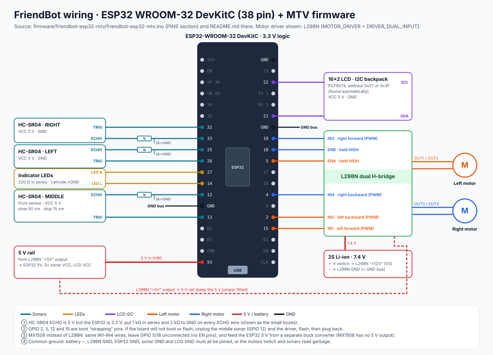

# 1 · FriendBot wiring



*Source of every pin below: the `PINS` section of [`firmware/friendbot-esp32-mtv/friendbot-esp32-mtv.ino`](../firmware/friendbot-esp32-mtv/friendbot-esp32-mtv.ino). FriendBot is based on [OpenBot](https://www.openbot.org); this wiring is the OpenBot "MTV" robot type with FriendBot's own sensor layout.*

## Parts list

| Part | Notes | Why this part |
|---|---|---|
| ESP32 WROOM-32 **DevKitC**, 38 pin | board type in Arduino: *ESP32 Dev Module* | has Bluetooth LE built in, so the iPhone can connect without a cable |
| L298N dual H-bridge | or MX1508 / L9110 / DRV8833 (see below) | lets a 3.3 V pin switch the 7.4 V motor current |
| 2 × DC gear motors + wheels, 1 caster | left and right | differential drive: turning = wheels at different speeds |
| 3 × HC-SR04 ultrasonic sonar | left · middle · right | lets the robot stop by itself before a wall |
| 3 × (1 kΩ + 2 kΩ) resistors | one pair per sonar ECHO | protects the 3.3 V ESP32 from the 5 V echo signal |
| 16×2 LCD with I2C backpack (PCF8574) | address 0x27 or 0x3F, found automatically | shows speed, link and distances without a phone |
| 2 × LED + 2 × 220 Ω | left / right indicators | blinks like a car's turn signals |
| 2S Li-ion battery 7.4 V + switch | motor power | — |
| Phone (Android or iPhone) | the robot's "brain" | microphone, speaker, camera, internet |

## Pin table

| Function | ESP32 GPIO | Goes to | Example of what you see |
|---|---|---|---|
| Left motor forward (PWM) | **15** | L298N IN1 | "go forward" → GPIO 15 gets PWM, GPIO 2 = 0 |
| Left motor backward (PWM) | **2** | L298N IN2 | "go back" → GPIO 2 gets PWM |
| Left motor enable | **5** | L298N ENA | held HIGH by the firmware |
| Right motor forward (PWM) | **19** | L298N IN3 | |
| Right motor backward (PWM) | **4** | L298N IN4 | |
| Right motor enable | **18** | L298N ENB | held HIGH |
| Middle sonar TRIG / ECHO | **13 / 12** | HC-SR04 (front) | LCD `M120` = 120 cm ahead |
| Left sonar TRIG / ECHO | **26 / 25** | HC-SR04 (left) | LCD `L 40` |
| Right sonar TRIG / ECHO | **32 / 33** | HC-SR04 (right) | LCD `Rmax` = nothing within 3 m |
| Left / right LED | **14 / 27** | LED + 220 Ω → GND | both blink = stopped |
| LCD SDA / SCL | **21 / 22** | I2C backpack | first line `FriendBot MTV` |
| 5 V in | **5V** pin | 5 V rail | |
| Ground | **GND** | common GND bus | |

The L298N's speed is set with PWM on the IN pins (not on ENA/ENB), so you can also leave the ENA/ENB jumper caps on and skip the GPIO 5/18 wires — both work. *Why the firmware still drives ENA/ENB HIGH:* if the caps are off, the motors would never run without it.

## Power

```
2S Li-ion 7.4 V ─ switch ─► L298N +12V (VS)
L298N +5V out ─► 5 V rail ─► ESP32 5V pin, 3× sonar VCC, LCD VCC
Battery −  ─► L298N GND ─► GND bus ─► ESP32 GND, sonar GND, LCD GND, LED cathodes
```

* Keep the L298N **5 V jumper fitted** so its regulator makes 5 V from the battery.
* **Never** take motor power from the ESP32's 3V3 or 5V pin. *Why:* a stalled motor can pull more than 1 A and the board will reset (the LCD flashes "Ready" again).
* **Android + USB cable:** the phone can also power the ESP32 through USB. If the 5 V rail is connected at the same time, put a diode (e.g. 1N5817) in the 5 V rail line to the ESP32 so the robot battery cannot push current back into the phone.

## Four rules that prevent most problems

1. **Echo divider on every sonar** — 1 kΩ from ECHO to the GPIO, 2 kΩ from the GPIO to GND. *Why:* 5 V × 2k/(1k+2k) = 3.3 V, which the ESP32 accepts. Without it the input pins slowly get damaged.
2. **Common ground** — battery −, L298N, ESP32, sonars and LCD all share GND. *Symptom if missing:* motors twitch at random and distances jump around.
3. **Strapping pins 2, 5, 12, 15** — the ESP32 reads them at power-on. If the board won't boot or flash, unplug the middle sonar (GPIO 12) and the motor driver, flash, then plug them back. *Why GPIO 12 matters most:* if it is HIGH at boot the chip selects the wrong flash voltage.
4. **Do not use GPIO 6–11** — they are wired to the flash chip inside the module; using them crashes the board.

## Using an MX1508 instead of an L298N

Same four wires (GPIO 15/2 → AIN1/AIN2, GPIO 19/4 → BIN1/BIN2), no enable pins (leave GPIO 5 and 18 free), and keep `MOTOR_DRIVER DRIVER_DUAL_INPUT`. The MX1508 has **no 5 V output**, so feed the 5 V rail from a small buck converter (7.4 V → 5 V, 1 A).

*Why choose it:* it is smaller and wastes less power (an L298N loses about 2 V as heat, so the motors see ~5.4 V instead of 7.4 V).

## First power-on check (wheels off the ground)

| Step | Expected |
|---|---|
| Switch on | both LEDs light briefly (lamp test), LCD shows `FriendBot MTV` / `Ready  BLE+USB` |
| Hand 20 cm in front of the middle sonar | LCD second line shows `M 20` (±2) |
| Connect the app, press **Forward** | both wheels turn forward, LCD `L 144 R 144  BLE` |
| One wheel turns backward | set `MOTOR_L_REVERSED` or `MOTOR_R_REVERSED` to 1 (or swap that motor's 2 wires) |
| Left / right distances swapped | swap the two sonar pin lines in the firmware |

## Questions to go deeper

1. Why does the L298N make the motors slower than the same battery on an MX1508? How many volts are lost and where does that energy go?
2. Why does each sonar need its own divider, but the TRIG wire does not?
3. What would happen if two sonars fired at the same time? (Hint: the firmware fires one every 40 ms — why?)
4. Why are strapping pins risky for inputs but usually fine for outputs?
5. How would you add a battery-voltage divider so the app can warn before the pack is empty — which free ADC pin would you pick (34, 35, 36 or 39), and why are those "input only" pins a good choice?
