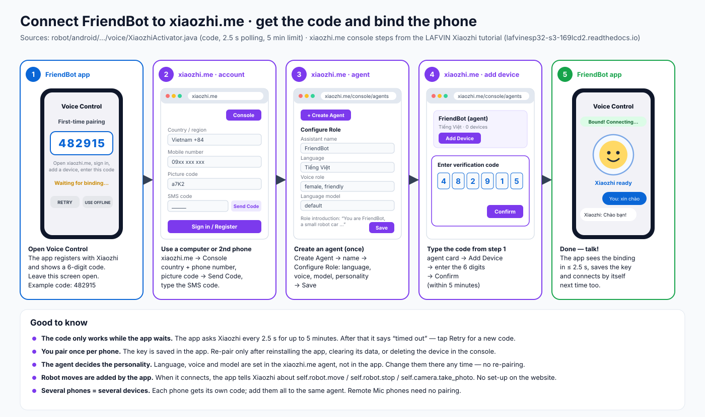

# 5 · Connect FriendBot to xiaozhi.me (get the code)

Voice Control needs a free **Xiaozhi** account. The phone acts as a Xiaozhi "device", the same way a Xiaozhi speaker board does: the app shows a **6-digit code**, and you type that code on **xiaozhi.me** to link the phone to your account. You do this **once per phone**.

*Sources:* the app side comes from `XiaozhiActivator.java` / `XiaozhiActivator.swift`: it registers at `https://api.tenclass.net/xiaozhi/ota/`, shows the code, polls every 2.5 s and gives up after 5 min. The website side follows the [LAFVIN Xiaozhi tutorial](https://lafvinesp32-s3-169lcd2.readthedocs.io/en/latest/Tutorial/1.xiaozhi.html). FriendBot's pairing follows [whisplay-xiaozhi](https://github.com/PiSugar/whisplay-xiaozhi).

> The website may show its buttons in Chinese. The names used here, with the usual Chinese label in brackets, are **Console** (控制台), **Create Agent** (新建智能体), **Configure Role** (配置角色) and **Add Device** (添加设备). Your browser's *Translate page* also works.

## ⚡ Thêm thiết bị vào Xiaozhi Console (cách nhanh)

Đã có tài khoản xiaozhi.me? Chỉ cần 5 bước:

1. Truy cập **<https://xiaozhi.me/console/agents>**
2. Tạo **Agent** mới (hoặc chọn Agent hiện có)
3. Click **"Add Device"**
4. Nhập **mã 6 số** từ ứng dụng FriendBot (màn hình **Voice Control** → *First-time pairing*)
5. ✅ Hoàn tất! Ứng dụng hiện **"Bound! Connecting…"** rồi **"Xiaozhi ready"**

> Mã chỉ dùng được trong **5 phút**. Hết hạn thì bấm **Retry** trên điện thoại để lấy mã mới. Chưa có tài khoản hoặc cần giải thích chi tiết: xem các bước 1–5 bên dưới.

*Quick version in English:* open <https://xiaozhi.me/console/agents> → create a new Agent (or pick an existing one) → **Add Device** → type the 6-digit code from the FriendBot app → done.

---

## What you need

* The FriendBot app on your phone ([Android](ANDROID_APP.md) or [iOS](IOS_APP.md)), with **internet** (Wi-Fi or mobile data).
* A **second screen** for the website: a computer, a tablet or another phone. *Why:* the code must stay on the FriendBot screen while you type it on the website.
* A **mobile phone number** that can receive an SMS for the account.

The robot does **not** need to be connected for pairing. Pairing links the *phone* to Xiaozhi, not the ESP32.

---

## Step 1 · Get the code in the app

1. Open the FriendBot app → home grid → **General → Voice Control**.
2. Allow the **microphone** when asked.
3. The **First-time pairing** panel appears with a 6-digit code, e.g. **`482915`**, and *"Waiting for binding…"*.
4. **Leave this screen open.** The app keeps checking with Xiaozhi every 2.5 seconds.

> No pairing panel? The phone was already paired. To pair again (for example with another account), tap the **gear → Sign in with xiaozhi.me**: the app shows a new code the same way.

## Step 2 · Create your xiaozhi.me account (first time only)

1. On the second screen, open **[xiaozhi.me](https://xiaozhi.me)** and click **Console** (控制台).
2. Choose your **country/region** (Vietnam = +84) and type your **mobile number**.
3. Type the **picture code** (captcha), click **Send Code**, then enter the **SMS code** you receive.
4. You are now in the console. *Optional:* set a password under your account name (top right), so next time you can log in without an SMS.

*Example:* Vietnam, +84, `0912 345 678` → SMS code `305127` → console opens.

## Step 3 · Create an agent (first time only)

An **agent** is "the personality" that answers. Your devices (phones) are attached to it.

1. Open **<https://xiaozhi.me/console/agents>**, click **Create Agent** (新建智能体), name it, e.g. **FriendBot**, and confirm.
2. On the agent card, click **Configure Role** (配置角色):

| Field | Suggested value | Why |
|---|---|---|
| Assistant name | FriendBot | what it calls itself |
| Language | **Tiếng Việt** (or English / 中文) | the language Xiaozhi listens and speaks in |
| Voice role | any voice you like | the voice you hear from the phone |
| Language model | leave the default | free and fast enough for driving |
| Role introduction | *"You are FriendBot, a small two-wheel robot car. Keep answers short. When the user asks you to move, use the robot tools."* | short answers = the robot reacts faster |

3. Click **Save**.

You do **not** need to add any robot commands on the website. *Why:* when the app connects, it tells Xiaozhi about its tools itself (`self.robot.move`, `self.robot.stop`, `self.camera.take_photo`). This uses the MCP part of the Xiaozhi protocol.

## Step 4 · Add the phone as a device (type the code)

1. Go to **<https://xiaozhi.me/console/agents>** (your agents list). On the agent card, click **Add Device** (添加设备).
2. Type the **6 digits** shown on the phone, e.g. `482915`.
3. Click **Confirm**.

Do this **within 5 minutes** of the code appearing. After 5 minutes the app stops waiting and shows *"timed out"*. Tap **Retry** on the phone for a new code.

## Step 5 · Check that it worked

Within a few seconds the phone shows **"Bound! Connecting…"**, then **"Xiaozhi ready"**, and the face appears.

* Say **"xin chào"**. Xiaozhi answers out loud and the conversation appears on screen.
* With the robot connected, say **"tiến lên 2 giây"**. The chip **» Move forward** appears and the robot drives for 2 s.

The key is saved in the app, so **next time Voice Control connects by itself**, with no code.

---

## When do I need a new code?

| Situation | New code? |
|---|---|
| Close and reopen the app | No |
| Restart the phone | No |
| Change the agent's language or voice on xiaozhi.me | No. The change applies on the next conversation |
| Reinstall the app, or clear its data/storage | **Yes**. The phone gets a new identity |
| Deleted the device in the xiaozhi.me console | **Yes**. Gear → Sign in with xiaozhi.me |
| A second phone should also talk to Xiaozhi | **Yes**, one code per phone, added to the same agent |
| A phone used only as **Remote Mic** | No. It uses the host phone's session |

## Troubleshooting

| Problem | What to do |
|---|---|
| No code appears, just "Creating device, please wait…" | the phone has no internet, or `api.tenclass.net` is blocked on this Wi-Fi. Switch to mobile data and tap **Retry** |
| No SMS from xiaozhi.me | check the country/region (+84 for Vietnam) and the number; wait 60 s and **Send Code** again |
| "Invalid code" on the website | the code expired (over 5 min) or a digit is wrong. Tap **Retry** on the phone and type the new one |
| Website says the device is added, phone still "Waiting…" | keep the Voice Control screen in front for a few seconds; if it timed out, tap **Retry** and add the new code |
| "Xiaozhi offline" later | internet dropped. Reopen the screen. If it keeps failing, gear → **Sign in with xiaozhi.me** to pair again |
| Xiaozhi answers in the wrong language | change **Language** in the agent's **Configure Role** on xiaozhi.me |
| Don't want an account | tap **Use offline mode**. Quick buttons and built-in keywords (EN/VI/中文) still drive the robot |

## Privacy in one paragraph

Your voice goes from the phone to Xiaozhi's servers (`api.tenclass.net`) to be turned into text and answered, and photos go there only when you or the assistant use the camera tool. The phone stores only its device ID and the access key, in the app's own storage. *Example:* uninstalling the app deletes the key on the phone. Delete the device in the console too if you want to remove it from your account.

## Questions to go deeper

1. Why does Xiaozhi use a code typed on a website instead of a username and password in the app? (Think about devices with no keyboard, like a speaker.)
2. Why must you link the *phone*, not the *robot*, to xiaozhi.me?
3. What would change if you ran your own `xiaozhi-esp32-server` instead of xiaozhi.me: where would the code come from, and who would hear your voice?
4. How does the "Role introduction" affect how fast and how safely the robot reacts to commands?
5. If ten classmates each pair a phone to the same agent, which settings do they share and which stay per phone?
